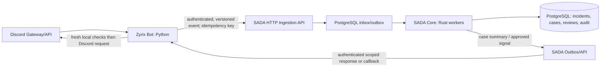

# Independent SADA Engine Architecture

## Purpose and boundary

SADA should become an independent security intelligence service. Zyrix Bot remains the Discord-facing product and policy enforcement point. The SADA service has no Discord bot token and must never call Discord's ban API. It accepts approved structured events, evaluates them, manages cases, and returns recommendations or authorized decision signals. Zyrix independently checks every signal before a local action.

This is a proposed future architecture, not deployed infrastructure. No Rust service, schema, or API is created by this document.

## Components

### Zyrix Bot (Python)

- Continues as the existing Python Discord bot.
- Owns Discord gateway events, commands, components, guild configuration, and actual Discord actions.
- Emits only approved structured security events through a narrow adapter.
- Receives SADA summaries/signals and checks guild scope, opt-in, case revision, membership, permissions, hierarchy, and local policy independently.
- Keeps ordinary moderation and AntiNuke functional when SADA is unavailable.

### SADA Core (Rust)

- Independent service with versioned API and event processing.
- Validates and deduplicates incidents.
- Preserves original reasons and evidence references while maintaining normalized reason categories separately.
- Evaluates evidence quality, source reliability indicators, cross-server correlations, and suspicious patterns.
- Manages cases, reviews, appeals/corrections, audit history, and recommendation generation.
- Emits approved decision signals, never Discord action commands.

### Persistent store

PostgreSQL is the recommended initial authoritative store because SADA needs durable relational records, transactions, unique constraints, case/incident relationships, and audit queries. Use migrations and a transactional outbox. Keep evidence blobs out of the primary tables where possible; store references with access controls and retention policy.

Redis is not required initially. Add it only for measured needs such as distributed rate limiting or short-lived cache/locks; do not make it the source of truth. NATS or another broker is also not required at initial scale: a database-backed inbox/outbox with bounded workers is simpler and recoverable. Introduce a broker only when measured throughput, fan-out, or independent consumer scaling justifies its operational cost. If adopted, retain idempotency and dead-letter handling.

## Communication design

### Initial transport recommendation

Start with HTTPS request/response for event ingestion and case-summary retrieval, plus durable PostgreSQL inbox/outbox processing. Use short timeouts so bot event handlers never block local actions. Bot sends an event asynchronously after or independently from the local action; if the SADA call fails, the adapter records a retryable result only if a durable local outbox is available. Do not pretend an event was accepted without durable acknowledgement.

For signals, Zyrix can poll or retrieve pending items by installation scope initially; a callback/webhook may be added if operationally justified. In either design, authenticate both sides, scope credentials to an installation, validate payload schema/version, use idempotency IDs, and protect integrity with TLS plus request signatures or equivalent service authentication. Rotate credentials and support revocation. Never place credentials in guild settings or Discord messages.

### Reliability properties

- **Idempotency:** stable source event ID or idempotency key; database unique constraint makes retries safe.
- **Retries:** bounded exponential backoff for transient failures only.
- **Dead letters:** persist exhausted events and expose safe operator diagnostics for correction/replay.
- **Ordering:** include source event time and server receipt time; do not assume global event order. Case revisions resolve update races.
- **Health:** separate liveness and readiness; report DB/worker/queue capability without exposing sensitive payloads.
- **Monitoring:** structured metrics for accepted/rejected events, queue age, processing failures, alert delivery, and partial enforcement. Do not log tokens, webhook URLs, private messages, or raw evidence.
- **Backpressure:** bounded request bodies, per-installation rate limits, and `429`/retry guidance.

## AntiNuke integration

AntiNuke is local, immediate protection. SADA is cross-server intelligence and investigation. SADA must never sit in the critical path for a local AntiNuke response.

Verified current integration point: `bot/cogs/antinuke/` contains active event-driven cogs registered by `bot/cogs/__init__.py`, including ban, kick, prune, channel, role, webhook, and bot-add handlers. These cogs are guild-local and use local AntiNuke configuration in `db/anti.db` through existing command/config patterns. Some current handlers can perform direct local punishment; this blueprint does not change their behavior. In particular, the current `antiprune.py` attribution is broad and must not be treated as trustworthy SADA evidence without a separately approved correction and tests.

Proposed event flow:

1. AntiNuke detects a suspicious local sequence.
2. It completes its existing configured local response without waiting on SADA.
3. A small adapter emits a structured event containing guild, event type, event time, affected-object identifiers, local action/result, audit correlation confidence, and a case reference where available. Avoid message bodies and secrets.
4. SADA deduplicates and evaluates the event as a signal/evidence item, not automatically as a verified user offense.
5. SADA may correlate it with other independently sourced patterns and open/update an investigation.
6. Only opted-in, relevant member guilds receive a suitable alert; local decisions remain local.

Define a versioned shared event envelope with `event_id`, `schema_version`, `source_installation_id`, `guild_id`, `event_type`, `occurred_at`, `observed_at`, `actor_id` when justified, `target/object` references, `local_action`, `result`, `evidence_status`, and a bounded metadata map. Each field must have validation and privacy rationale. A suspicious AntiNuke event should not be categorized as a verified malicious user incident absent reliable actor attribution and review.

## Security boundary for enforcement

SADA sends a recommendation or approved global decision signal referencing case ID, decision revision, allowed scope, and expiry. It never sends a raw “ban this ID” command accepted without context. Zyrix Bot then independently checks:

1. Signal authentication, integrity, expiry, and replay status.
2. Global approval status and reviewer authority metadata.
3. This guild's explicit global enforcement opt-in and active policy.
4. Current target membership.
5. Bot Ban Members permission and role hierarchy.
6. Any local blocklist, exemption, or policy conflict.
7. Idempotency and current case revision.

It records success, failure, skipped, and unavailable outcomes independently. A global decision can be approved while a guild enforcement attempt fails; user-facing status must reflect that distinction. Reversal cancels pending signals and prompts local review; SADA cannot force unban.

## Why Rust for SADA Core

Rust is a sound choice for an independent service that needs predictable performance, safe concurrency, strong types for event schemas, and memory safety without a garbage collector. Its compile-time guarantees can reduce classes of memory and data-race bugs in long-running ingestion/analysis workers. These benefits do not replace authorization design, tests, operational controls, or careful privacy policy.

The existing Python Discord bot should not be rewritten for hypothetical performance. It already owns Discord library integration and commands; rewriting would expand migration risk and could break working moderation features. Keep the service boundary narrow and optimize only measured bottlenecks.

## Deployment options and open choice

Start with a separately deployable SADA API/worker and PostgreSQL, even if the first deployment runs as one service process with worker tasks. Keep it isolated from the bot's process and database. A broker or separate worker fleet can follow measured demand. The production topology, hosting provider, region, disaster recovery objectives, and data residency are **OPEN DECISIONS**.

## Failure isolation

When SADA is unavailable, Zyrix logs a safe diagnostic, queues only if the approved durable adapter design supports it, and continues ordinary commands, local moderation, and AntiNuke. No SADA failure may disable or delay local enforcement. SADA readiness failure affects SADA signals only; it must not make the bot claim its own local protection is unavailable.

## Build sequence

Follow the staged plan in [Implementation Roadmap](../global-ban-system/15-implementation-roadmap.md): policy/contracts and storage first, then event adapter, evidence classification, correlation, local alerts, global review/enforcement signals, and appeals/operations. Each stage has an explicit test and completion gate; do not enable production collection by default.
