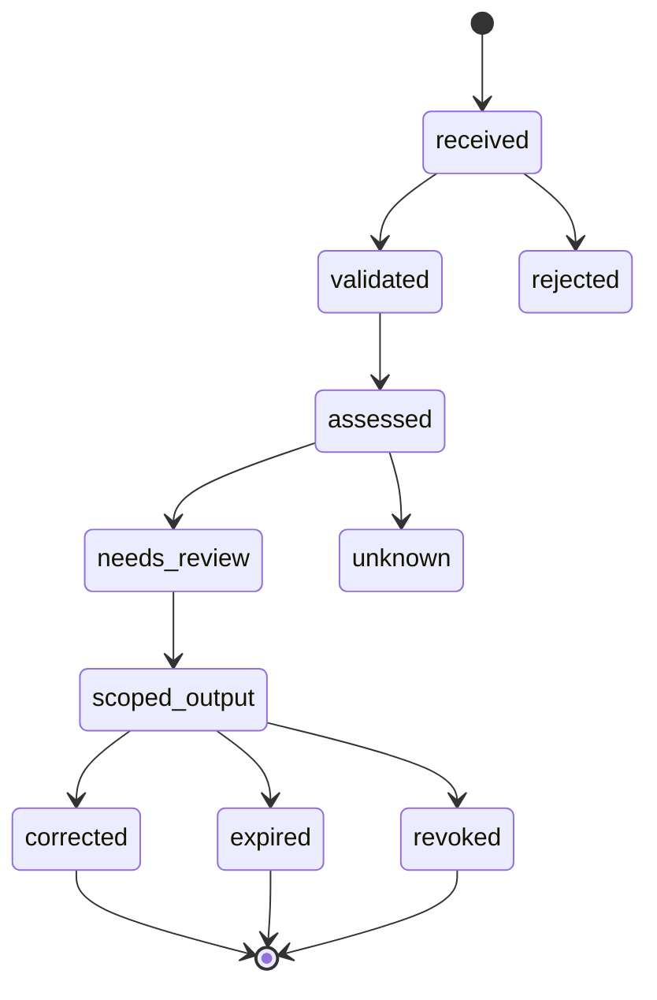

# 03 — Feature workflow: Advanced Spam Evasion Detection

## Workflow

1. **Authorize source:** verify installation, guild grant, feature opt-in and consent revision. A caller-supplied guild ID is not authority.
2. **Accept event:** validate event type, schema, body bounds, timestamp and idempotency; commit the shared inbox and return a stable receipt.
3. **Normalize:** Guild-authorized message event; Unicode code points; normalized token/character sequence; timestamps; mention/link counts; moderation outcome reference. Preserve original source references and distinguish observed time, received time and attribution quality.
4. **Assess:** Preserve original digest and normalization version; use Unicode NFKC plus explicit confusable mapping version; near-duplicate similarity is a candidate factor, not universal threshold. Store factors and exclusions with algorithm/policy version; do not silently convert absent fields into negatives.
5. **Link and review:** link the output to shared incident, evidence and timeline records. A reviewer sees source, derived fields, missingness and correction state. High-impact decisions follow shared case quorum and appeal policy.
6. **Distribute:** publish only an authorized, expiring and revision-bound summary through the shared outbox; cancellation/reversal supersedes pending work.
7. **Close:** record disposition, correction, expiry or revocation. Keep historical revision linkage under retention policy.

## Human review and edge cases

A finding can be confirmed, disputed, false positive, inconclusive or unavailable without overwriting the source event. Low sample size, missing permissions, stale baselines, conflicting sources, ambiguous attribution, and revoked consent must remain explicit. No single anomaly or score triggers a Discord action.
