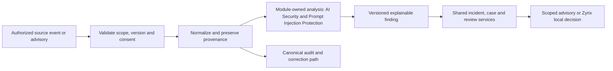

# AI Security and Prompt Injection Protection

**Catalogue module 49 of 49. Status: proposed specification only; not implemented or deployed.**

## Purpose

Constrain optional AI summarization/classification over untrusted evidence and preserve deterministic, human-led decisions.

## What it does

Treat evidence as data; isolate parser; pass bounded quoted content without authority; disable tools by default; validate structured output; record prompt/model/policy refs; present recommendation with source links; permit manual workflow if AI unavailable.

## What it must never do

- It must not execute Discord moderation or configuration changes. Zyrix Bot remains the only Discord action boundary and rechecks local consent, permissions and role hierarchy.
- It must not treat a score, anomaly or single report as proof or punishment authority.
- It must not bypass guild opt-in, shared case/review, evidence, identity or audit contracts.

## Signals and workflow

**Inputs:** Untrusted evidence refs; sanitized extracted text; task template/version; model/provider metadata; tool allowlist; reviewer output.



No model output changes case state, consent, permissions, severity authority or enforcement. Injection indicators can be surfaced as content risks but not trusted instructions. Every output is labeled generated, versioned and correctable.

## Ownership and integration

This module owns only domain-specific observations, snapshots, assessments and indicator references. It reuses canonical installation/consent, event inbox, incident/evidence, case/review, delivery/outbox and audit records. It does not create separate authentication, case management, evidence vault, reviewer quorum or audit systems.

Dependencies: [Evidence Vault](../evidence-vault/README.md), [Threat Intelligence API](../threat-intelligence-api/README.md), [Trust and Reliability Engine](../trust-and-reliability-engine/README.md), Case/Review service, Security Simulation Mode..

## Security, privacy and limitations

No tools/network by default; minimize/redact evidence; provider boundary review; audit prompt/template metadata but not secrets; prohibit autonomous actions. Prompt filters cannot guarantee injection detection; external model providers may retain data; do not send private content without explicit policy/contract.

Cross-guild sharing requires explicit purpose and permission. Missing, stale or inaccessible data is represented as unknown/partial. Corrections and revocations are versioned and propagate to pending deliveries.

## API and event contract

**Method:** `POST`. Proposed internal endpoint: `POST /v1/ai/assessments`. It uses the shared `/v1` authentication and authorization model, guild scope from authenticated grants, request ID, schema version, idempotency key, bounded JSON payload, and shared error shape. The endpoint accepts observations or recommendations only; it does not execute Discord actions. A durable inbox receipt is returned only after commit. Duplicate key + same canonical body returns the original receipt; changed body returns `409`. Retry only transient `retryable=true` errors.

Example request:

```json
{
  "schema_version": "1.0",
  "event_id": "018f0000-0000-7000-8000-000000000001",
  "source_guild_id": "123456789012345678",
  "occurred_at": "2026-11-16T10:00:00Z",
  "consent_version": "guild-consent-7",
  "correlation_id": "018f0000-0000-7000-8000-000000000003",
  "payload": { "observation_ref": "opaque-reference", "type": "module-specific" }
}
```

Example accepted response:

```json
{"event_id":"018f0000-0000-7000-8000-000000000001","receipt_id":"018f0000-0000-7000-8000-000000000004","status":"accepted","duplicate":false}
```

## Data model

See [module data model](data-model.md). Tables below are proposals only; canonical IDs and shared ownership follow [platform storage architecture](../system-architecture/05-database-and-storage-architecture.md). Retention and access remain subject to the platform policy register.

## Design status and implementation phase

**Current status:** architecture proposal. **Proposed phase:** Phase 7 only after privacy review, model threat assessment and non-AI workflow. No runtime behavior or algorithm has been validated. Resolve before implementation: Model/provider, data processing terms, retention, evaluation corpus and permitted tasks require legal/security review.

## Documents

- [01 Overview and objectives](01-overview-and-objectives.md)
- [02 System architecture](02-system-architecture.md)
- [03 Feature workflow](03-feature-workflow.md)
- [04 Detection and contract details](04-detection-and-contract-details.md)
- [data-model.md](data-model.md)
- [05 Security and abuse prevention](05-security-and-abuse-prevention.md)
- [06 Testing and acceptance criteria](06-testing-and-acceptance-criteria.md)
- [07 Implementation roadmap](07-implementation-roadmap.md)
