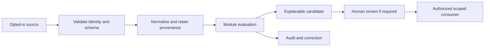

# Attack Campaign Tracker

**Status: proposed architecture; documentation only.** This module is not implemented or deployed.

## Purpose and problems solved

Group related incidents into versioned investigations while preserving uncertainty and source facts. It receives Candidate links from time, indicators, fingerprints, human edges with provenance/version. It produces Campaign lifecycle, evidence graph, timeline, inclusion/exclusion, review state.

## What it does

- Open candidate, propose links, evaluate independence/time, review, merge/split/close with history.
- Keeps source observations, derived assessment, human decision, and local action result distinct.
- Versions rules and identifies inputs, exclusions, limitations, and reviewer state.

## What it must never do

No merge from weak indicator or campaign membership as individual guilt.

## Main workflow

Open candidate, propose links, evaluate independence/time, review, merge/split/close with history.

## Data and API boundaries

Proposed module projections: campaigns, campaign_revisions, campaign_incident_links, relationship_edges. Canonical events, incidents, evidence, cases and audit are defined once in [platform data architecture](../system-architecture/05-database-and-storage-architecture.md) and [shared standards](../shared-standards/README.md). Store typed references instead of duplicating source records. API conventions are shared with [Threat Intelligence API](../threat-intelligence-api/README.md).

## Security and privacy

Risks include Over-connection, hijack, stale infrastructure, circular corroboration. Enforce least privilege, opt-in, minimization, audited sensitive reads, bounded inputs, explicit retention, scoped summaries, and fail-closed authorization. On dependency outage, expose unavailable/stale status; never turn missing data into clean findings or action authority. Retries use [idempotent delivery](../shared-standards/07-idempotency-and-delivery-standard.md).

## Dependencies and integration

Attack Campaign Tracker connects with:
- [Threat Intelligence Network](../threat-intelligence-network/README.md)
- [Threat DNA](../threat-dna/README.md)
- [Scam and Phishing Intelligence](../scam-and-phishing-intelligence/README.md)
- [Early Raid Detection](../early-raid-detection/README.md)
- [Incident Timeline](../incident-timeline/README.md)
- [Evidence Vault](../evidence-vault/README.md)
- [Trust and Reliability Engine](../trust-and-reliability-engine/README.md)
- [Security Advisory Network](../security-advisory-network/README.md)

Cross-module records use stable event, incident, evidence, case, campaign and correlation IDs. The source context owns original evidence.

## Testing and acceptance

Use synthetic fixtures, deterministic clocks, disposable PostgreSQL, fake service identities and Discord API stubs. Primary invariant: Reversal recomputes current campaign; merge/split preserves revision history. Also test tenant isolation, duplicate/revoked events, corrections, migration rollback, restart recovery and absence of forbidden fields in logs. No live Discord action or accuracy claim.

## Implementation phase

**Proposed phase:** 4 after graph/evidence/timeline. Prerequisites include shared contracts, identity, consent, retention, audit, and outbox. See [platform roadmap](../implementation-roadmap/README.md).

## Open decisions

Merge gate; independent sources; lifecycle owner; public language. Thresholds, retention and authority rules remain unresolved until approved and versioned.

## Data model appendix

[Module-owned PostgreSQL tables, keys, indexes, and retention notes](data-model.md).

## Document index

| # | Document | Purpose |
|---|---|---|
| 01 | [Overview and objectives](01-overview-and-objectives.md) | Contract, safeguards and implementation gate for overview and objectives. |
| 02 | [Campaign data model](02-campaign-data-model.md) | Contract, safeguards and implementation gate for campaign data model. |
| 03 | [Incident grouping and correlation](03-incident-grouping-and-correlation.md) | Contract, safeguards and implementation gate for incident grouping and correlation. |
| 04 | [Campaign lifecycle](04-campaign-lifecycle.md) | Contract, safeguards and implementation gate for campaign lifecycle. |
| 05 | [Campaign evidence and timeline](05-campaign-evidence-and-timeline.md) | Contract, safeguards and implementation gate for campaign evidence and timeline. |
| 06 | [Review and correction](06-review-and-correction.md) | Contract, safeguards and implementation gate for review and correction. |
| 07 | [Testing and acceptance criteria](07-testing-and-acceptance-criteria.md) | Contract, safeguards and implementation gate for testing and acceptance criteria. |
| 08 | [Implementation roadmap](08-implementation-roadmap.md) | Contract, safeguards and implementation gate for implementation roadmap. |
