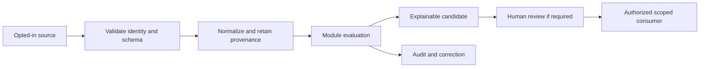

# Attack Impact Simulator

**Status: proposed architecture; documentation only.** This module is not implemented or deployed.

## Purpose and problems solved

Estimate consequence of a proposed action against a frozen local snapshot. It receives Action plan, target set, snapshot revision, policy, uncertainty, reversibility. It produces Read-only estimate, affected counts, exclusions, false-positive scenarios, rollback requirements.

## What it does

- Freeze input, validate age, dry-run rules, show uncertainty, reviewer revises or accepts.
- Keeps source observations, derived assessment, human decision, and local action result distinct.
- Versions rules and identifies inputs, exclusions, limitations, and reviewer state.

## What it must never do

No Discord write credential, mutating endpoint, or real action queue.

## Main workflow

Freeze input, validate age, dry-run rules, show uncertainty, reviewer revises or accepts.

## Data and API boundaries

Proposed module projections: simulation_runs, simulation_inputs, impact_estimates, rule_versions. Canonical events, incidents, evidence, cases and audit are defined once in [platform data architecture](../system-architecture/05-database-and-storage-architecture.md) and [shared standards](../shared-standards/README.md). Store typed references instead of duplicating source records. API conventions are shared with [Threat Intelligence API](../threat-intelligence-api/README.md).

## Security and privacy

Risks include Stale input, underestimated cascade, credential exposure. Enforce least privilege, opt-in, minimization, audited sensitive reads, bounded inputs, explicit retention, scoped summaries, and fail-closed authorization. On dependency outage, expose unavailable/stale status; never turn missing data into clean findings or action authority. Retries use [idempotent delivery](../shared-standards/07-idempotency-and-delivery-standard.md).

## Dependencies and integration

Attack Impact Simulator connects with:

- [Emergency Response Playbooks](../emergency-response-playbooks/README.md)
- [Security Health Monitor](../security-health-monitor/README.md)
- [Incident Recovery Assistant](../incident-recovery-assistant/README.md)
- [Incident Timeline](../incident-timeline/README.md)
- [Global Ban System](../global-ban-system/README.md)
- [Security Observatory](../security-observatory/README.md)

Cross-module records use stable event, incident, evidence, case, campaign and correlation IDs. The source context owns original evidence.

## Testing and acceptance

Use synthetic fixtures, deterministic clocks, disposable PostgreSQL, fake service identities and Discord API stubs. Primary invariant: Synthetic plan makes no mutation call; missing permission data yields unknown. Also test tenant isolation, duplicate/revoked events, corrections, migration rollback, restart recovery and absence of forbidden fields in logs. No live Discord action or accuracy claim.

## Implementation phase

**Proposed phase:** 5 before action workflows. Prerequisites include shared contracts, identity, consent, retention, audit, and outbox. See [platform roadmap](../implementation-roadmap/README.md).

## Open decisions

Freshness; estimate presentation; simulation retention. Thresholds, retention and authority rules remain unresolved until approved and versioned.

## Data model appendix

[Module-owned PostgreSQL tables, keys, indexes, and retention notes](data-model.md).

## Document index

| # | Document | Purpose |
|---|---|---|
| 01 | [Overview and objectives](01-overview-and-objectives.md) | Contract, safeguards and implementation gate for overview and objectives. |
| 02 | [Simulation architecture](02-simulation-architecture.md) | Contract, safeguards and implementation gate for simulation architecture. |
| 03 | [Enforcement impact analysis](03-enforcement-impact-analysis.md) | Contract, safeguards and implementation gate for enforcement impact analysis. |
| 04 | [False-positive impact estimation](04-false-positive-impact-estimation.md) | Contract, safeguards and implementation gate for false-positive impact estimation. |
| 05 | [Reversibility and rollback analysis](05-reversibility-and-rollback-analysis.md) | Contract, safeguards and implementation gate for reversibility and rollback analysis. |
| 06 | [Reviewer decision support](06-reviewer-decision-support.md) | Contract, safeguards and implementation gate for reviewer decision support. |
| 07 | [Simulation safety and isolation](07-simulation-safety-and-isolation.md) | Contract, safeguards and implementation gate for simulation safety and isolation. |
| 08 | [Testing and acceptance criteria](08-testing-and-acceptance-criteria.md) | Contract, safeguards and implementation gate for testing and acceptance criteria. |
| 09 | [Implementation roadmap](09-implementation-roadmap.md) | Contract, safeguards and implementation gate for implementation roadmap. |
