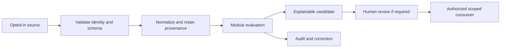

# Ban Evasion Intelligence

**Status: proposed architecture; documentation only.** This module is not implemented or deployed.

## Purpose and problems solved

Provide cautious candidate links where permitted signals suggest possible ban evasion. It receives Approved public metadata and opt-in guild observations, time, source confidence. It produces Candidate relationship, signal list, limits and review state.

## What it does

- Confirm consent, gather allowed signals, exclude prohibited identifiers, compare multiple signals, human review.
- Keeps source observations, derived assessment, human decision, and local action result distinct.
- Versions rules and identifies inputs, exclusions, limitations, and reviewer state.

## What it must never do

No IP/device fingerprints, weak-similarity identity claims, surveillance, automatic punishment.

## Main workflow

Confirm consent, gather allowed signals, exclude prohibited identifiers, compare multiple signals, human review.

## Data and API boundaries

Proposed module projections: evasion_observations, relationship_edges, evidence_refs, reviewer_votes. Canonical events, incidents, evidence, cases and audit are defined once in [platform data architecture](../system-architecture/05-database-and-storage-architecture.md) and [shared standards](../shared-standards/README.md). Store typed references instead of duplicating source records. API conventions are shared with [Threat Intelligence API](../threat-intelligence-api/README.md).

## Security and privacy

Risks include False identity links, shared accounts, mimicry, discriminatory proxies. Enforce least privilege, opt-in, minimization, audited sensitive reads, bounded inputs, explicit retention, scoped summaries, and fail-closed authorization. On dependency outage, expose unavailable/stale status; never turn missing data into clean findings or action authority. Retries use [idempotent delivery](../shared-standards/07-idempotency-and-delivery-standard.md).

## Dependencies and integration

Ban Evasion Intelligence connects with:

- [Threat Intelligence Network](../threat-intelligence-network/README.md)
- [Threat DNA](../threat-dna/README.md)
- [Incident Timeline](../incident-timeline/README.md)
- [Evidence Vault](../evidence-vault/README.md)
- [Trust and Reliability Engine](../trust-and-reliability-engine/README.md)
- [Global Ban System](../global-ban-system/README.md)

Cross-module records use stable event, incident, evidence, case, campaign and correlation IDs. The source context owns original evidence.

## Testing and acceptance

Use synthetic fixtures, deterministic clocks, disposable PostgreSQL, fake service identities and Discord API stubs. Primary invariant: Display name alone never high confidence; multiple signals still require review. Also test tenant isolation, duplicate/revoked events, corrections, migration rollback, restart recovery and absence of forbidden fields in logs. No live Discord action or accuracy claim.

## Implementation phase

**Proposed phase:** 7 after legal/privacy and false-positive review. Prerequisites include shared contracts, identity, consent, retention, audit, and outbox. See [platform roadmap](../implementation-roadmap/README.md).

## Open decisions

Allowed signals; weights; retention; visibility. Thresholds, retention and authority rules remain unresolved until approved and versioned.

## Data model appendix

[Module-owned PostgreSQL tables, keys, indexes, and retention notes](data-model.md).

## Document index

| # | Document | Purpose |
|---|---|---|
| 01 | [Overview and objectives](01-overview-and-objectives.md) | Contract, safeguards and implementation gate for overview and objectives. |
| 02 | [Detection architecture](02-detection-architecture.md) | Contract, safeguards and implementation gate for detection architecture. |
| 03 | [Permitted signal collection](03-permitted-signal-collection.md) | Contract, safeguards and implementation gate for permitted signal collection. |
| 04 | [Multi-signal correlation](04-multi-signal-correlation.md) | Contract, safeguards and implementation gate for multi-signal correlation. |
| 05 | [Confidence and explainability](05-confidence-and-explainability.md) | Contract, safeguards and implementation gate for confidence and explainability. |
| 06 | [Human review and local enforcement](06-human-review-and-local-enforcement.md) | Contract, safeguards and implementation gate for human review and local enforcement. |
| 07 | [Privacy and data retention](07-privacy-and-data-retention.md) | Contract, safeguards and implementation gate for privacy and data retention. |
| 08 | [False-positive and bias prevention](08-false-positive-and-bias-prevention.md) | Contract, safeguards and implementation gate for false-positive and bias prevention. |
| 09 | [Testing and acceptance criteria](09-testing-and-acceptance-criteria.md) | Contract, safeguards and implementation gate for testing and acceptance criteria. |
| 10 | [Implementation roadmap](10-implementation-roadmap.md) | Contract, safeguards and implementation gate for implementation roadmap. |
