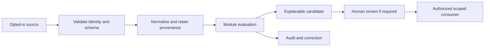

# Early Raid Detection

**Status: proposed architecture; documentation only.** This module is not implemented or deployed.

## Purpose and problems solved

Warn guild staff early using explainable local join and message velocity signals. It receives Join times, message/mention counts, channel, optional approved account-age bucket, local baseline. It produces Severity-banded explanation and reversible mitigation suggestions.

## What it does

- Aggregate locally, compare baseline, combine signals, explain deviation, alert staff, await human choice.
- Keeps source observations, derived assessment, human decision, and local action result distinct.
- Versions rules and identifies inputs, exclusions, limitations, and reviewer state.

## What it must never do

Rates alone do not prove coordination; no automatic bans, timeouts, locks, or configuration edits.

## Main workflow

Aggregate locally, compare baseline, combine signals, explain deviation, alert staff, await human choice.

## Data and API boundaries

Proposed module projections: guild_baselines, detection_windows, incidents, evidence_refs, alerts. Canonical events, incidents, evidence, cases and audit are defined once in [platform data architecture](../system-architecture/05-database-and-storage-architecture.md) and [shared standards](../shared-standards/README.md). Store typed references instead of duplicating source records. API conventions are shared with [Threat Intelligence API](../threat-intelligence-api/README.md).

## Security and privacy

Risks include Slow raids, legitimate surges, cold start, alert manipulation, privacy leak. Enforce least privilege, opt-in, minimization, audited sensitive reads, bounded inputs, explicit retention, scoped summaries, and fail-closed authorization. On dependency outage, expose unavailable/stale status; never turn missing data into clean findings or action authority. Retries use [idempotent delivery](../shared-standards/07-idempotency-and-delivery-standard.md).

## Dependencies and integration

Early Raid Detection connects with:
- [Threat DNA](../threat-dna/README.md)
- [Incident Timeline](../incident-timeline/README.md)
- [Evidence Vault](../evidence-vault/README.md)
- [Emergency Response Playbooks](../emergency-response-playbooks/README.md)
- [Attack Impact Simulator](../attack-impact-simulator/README.md)
- [Security Advisory Network](../security-advisory-network/README.md)

Cross-module records use stable event, incident, evidence, case, campaign and correlation IDs. The source context owns original evidence.

## Testing and acceptance

Use synthetic fixtures, deterministic clocks, disposable PostgreSQL, fake service identities and Discord API stubs. Primary invariant: Join and mention burst outranks one noisy signal; missing baseline is unknown. Also test tenant isolation, duplicate/revoked events, corrections, migration rollback, restart recovery and absence of forbidden fields in logs. No live Discord action or accuracy claim.

## Implementation phase

**Proposed phase:** 4 after local events and consent. Prerequisites include shared contracts, identity, consent, retention, audit, and outbox. See [platform roadmap](../implementation-roadmap/README.md).

## Open decisions

Baseline windows; sample sizes; alert thresholds; account-age use; retention. Thresholds, retention and authority rules remain unresolved until approved and versioned.

## Data model appendix

[Module-owned PostgreSQL tables, keys, indexes, and retention notes](data-model.md).

## Document index

| # | Document | Purpose |
|---|---|---|
| 01 | [Overview and objectives](01-overview-and-objectives.md) | Contract, safeguards and implementation gate for overview and objectives. |
| 02 | [Detection architecture](02-detection-architecture.md) | Contract, safeguards and implementation gate for detection architecture. |
| 03 | [Join rate and velocity analysis](03-join-rate-and-velocity-analysis.md) | Contract, safeguards and implementation gate for join rate and velocity analysis. |
| 04 | [Message and mention patterns](04-message-and-mention-patterns.md) | Contract, safeguards and implementation gate for message and mention patterns. |
| 05 | [Coordinated activity detection](05-coordinated-activity-detection.md) | Contract, safeguards and implementation gate for coordinated activity detection. |
| 06 | [Baselines and anomaly detection](06-baselines-and-anomaly-detection.md) | Contract, safeguards and implementation gate for baselines and anomaly detection. |
| 07 | [Risk scoring and alerts](07-risk-scoring-and-alerts.md) | Contract, safeguards and implementation gate for risk scoring and alerts. |
| 08 | [Response and mitigation workflows](08-response-and-mitigation-workflows.md) | Contract, safeguards and implementation gate for response and mitigation workflows. |
| 09 | [Security and abuse prevention](09-security-and-abuse-prevention.md) | Contract, safeguards and implementation gate for security and abuse prevention. |
| 10 | [Testing and acceptance criteria](10-testing-and-acceptance-criteria.md) | Contract, safeguards and implementation gate for testing and acceptance criteria. |
| 11 | [Implementation roadmap](11-implementation-roadmap.md) | Contract, safeguards and implementation gate for implementation roadmap. |
