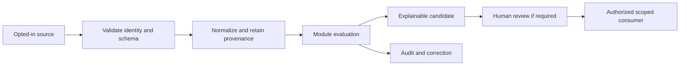

# Emergency Response Playbooks

**Status: proposed architecture; documentation only.** This module is not implemented or deployed.

## Purpose and problems solved

Coordinate human-approved containment, communication, and recovery steps. It receives Reviewed case severity/confidence, guild scope, playbook version, local state, prerequisites. It produces Checklist, approvals, execution receipts, rollback path, unresolved steps.

## What it does

- Select incident class, assess impact, recommend minimum response, approve scope, Zyrix executes, reconcile.
- Keeps source observations, derived assessment, human decision, and local action result distinct.
- Versions rules and identifies inputs, exclusions, limitations, and reviewer state.

## What it must never do

No score-triggered action, cross-guild action, or irreversible step without explicit local authorization.

## Main workflow

Select incident class, assess impact, recommend minimum response, approve scope, Zyrix executes, reconcile.

## Data and API boundaries

Proposed module projections: playbook_versions, playbook_runs, response_steps, approvals, execution_receipts. Canonical events, incidents, evidence, cases and audit are defined once in [platform data architecture](../system-architecture/05-database-and-storage-architecture.md) and [shared standards](../shared-standards/README.md). Store typed references instead of duplicating source records. API conventions are shared with [Threat Intelligence API](../threat-intelligence-api/README.md).

## Security and privacy

Risks include Urgency abuse, compromised approver, stale case, duplicate/destructive action. Enforce least privilege, opt-in, minimization, audited sensitive reads, bounded inputs, explicit retention, scoped summaries, and fail-closed authorization. On dependency outage, expose unavailable/stale status; never turn missing data into clean findings or action authority. Retries use [idempotent delivery](../shared-standards/07-idempotency-and-delivery-standard.md).

## Dependencies and integration

Emergency Response Playbooks connects with:
- [Early Raid Detection](../early-raid-detection/README.md)
- [Scam and Phishing Intelligence](../scam-and-phishing-intelligence/README.md)
- [Suspicious Admin Activity](../suspicious-admin-activity/README.md)
- [Security Health Monitor](../security-health-monitor/README.md)
- [Attack Impact Simulator](../attack-impact-simulator/README.md)
- [Incident Recovery Assistant](../incident-recovery-assistant/README.md)
- [Incident Timeline](../incident-timeline/README.md)

Cross-module records use stable event, incident, evidence, case, campaign and correlation IDs. The source context owns original evidence.

## Testing and acceptance

Use synthetic fixtures, deterministic clocks, disposable PostgreSQL, fake service identities and Discord API stubs. Primary invariant: Revoked approval blocks execution; ambiguous timeout reconciles; partial recovery stays visible. Also test tenant isolation, duplicate/revoked events, corrections, migration rollback, restart recovery and absence of forbidden fields in logs. No live Discord action or accuracy claim.

## Implementation phase

**Proposed phase:** 6 after authorization and rollback. Prerequisites include shared contracts, identity, consent, retention, audit, and outbox. See [platform roadmap](../implementation-roadmap/README.md).

## Open decisions

Automation scope; approval quorum; emergency fallback; response goals. Thresholds, retention and authority rules remain unresolved until approved and versioned.

## Data model appendix

[Module-owned PostgreSQL tables, keys, indexes, and retention notes](data-model.md).

## Document index

| # | Document | Purpose |
|---|---|---|
| 01 | [Overview and objectives](01-overview-and-objectives.md) | Contract, safeguards and implementation gate for overview and objectives. |
| 02 | [Response engine architecture](02-response-engine-architecture.md) | Contract, safeguards and implementation gate for response engine architecture. |
| 03 | [Threat severity and prioritization](03-threat-severity-and-prioritization.md) | Contract, safeguards and implementation gate for threat severity and prioritization. |
| 04 | [Raid response playbooks](04-raid-response-playbooks.md) | Contract, safeguards and implementation gate for raid response playbooks. |
| 05 | [Phishing and scam response](05-phishing-and-scam-response.md) | Contract, safeguards and implementation gate for phishing and scam response. |
| 06 | [Compromised admin response](06-compromised-admin-response.md) | Contract, safeguards and implementation gate for compromised admin response. |
| 07 | [Permission and configuration response](07-permission-and-configuration-response.md) | Contract, safeguards and implementation gate for permission and configuration response. |
| 08 | [Human approval and execution controls](08-human-approval-and-execution-controls.md) | Contract, safeguards and implementation gate for human approval and execution controls. |
| 09 | [Recovery and rollback](09-recovery-and-rollback.md) | Contract, safeguards and implementation gate for recovery and rollback. |
| 10 | [Testing and acceptance criteria](10-testing-and-acceptance-criteria.md) | Contract, safeguards and implementation gate for testing and acceptance criteria. |
| 11 | [Implementation roadmap](11-implementation-roadmap.md) | Contract, safeguards and implementation gate for implementation roadmap. |
