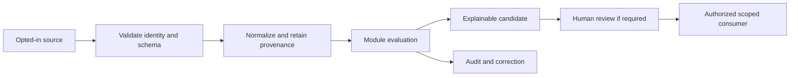

# Evidence Vault

**Status: proposed architecture; documentation only.** This module is not implemented or deployed.

## Purpose and problems solved

Store structured references and approved artifacts with integrity, access, retention, deletion. It receives Evidence metadata/reference, authorized artifact, digest, provenance, retention class. It produces Opaque evidence ID and integrity metadata; content separately authorized.

## What it does

- Authorize, validate size/type, minimize/redact, encrypt, hash, store, audit reads, expire/delete.
- Keeps source observations, derived assessment, human decision, and local action result distinct.
- Versions rules and identifies inputs, exclusions, limitations, and reviewer state.

## What it must never do

No public blobs, private content by default, or claim hash proves truth.

## Main workflow

Authorize, validate size/type, minimize/redact, encrypt, hash, store, audit reads, expire/delete.

## Data and API boundaries

Proposed module projections: evidence_objects, evidence_versions, evidence_access_events, retention_holds. Canonical events, incidents, evidence, cases and audit are defined once in [platform data architecture](../system-architecture/05-database-and-storage-architecture.md) and [shared standards](../shared-standards/README.md). Store typed references instead of duplicating source records. API conventions are shared with [Threat Intelligence API](../threat-intelligence-api/README.md).

## Security and privacy

Risks include Insider access, key compromise, malicious files, orphan objects, legal holds. Enforce least privilege, opt-in, minimization, audited sensitive reads, bounded inputs, explicit retention, scoped summaries, and fail-closed authorization. On dependency outage, expose unavailable/stale status; never turn missing data into clean findings or action authority. Retries use [idempotent delivery](../shared-standards/07-idempotency-and-delivery-standard.md).

## Dependencies and integration

Evidence Vault connects with:
- [Incident Timeline](../incident-timeline/README.md)
- [Trust and Reliability Engine](../trust-and-reliability-engine/README.md)
- [Attack Campaign Tracker](../attack-campaign-tracker/README.md)
- [Global Ban System](../global-ban-system/README.md)

Cross-module records use stable event, incident, evidence, case, campaign and correlation IDs. The source context owns original evidence.

## Testing and acceptance

Use synthetic fixtures, deterministic clocks, disposable PostgreSQL, fake service identities and Discord API stubs. Primary invariant: Unauthorized read denied; mismatch blocks display; expiry reconciles blob and metadata. Also test tenant isolation, duplicate/revoked events, corrections, migration rollback, restart recovery and absence of forbidden fields in logs. No live Discord action or accuracy claim.

## Implementation phase

**Proposed phase:** 1 policy before capture. Prerequisites include shared contracts, identity, consent, retention, audit, and outbox. See [platform roadmap](../implementation-roadmap/README.md).

## Open decisions

Evidence classes; duration; rights; provider; hold authority. Thresholds, retention and authority rules remain unresolved until approved and versioned.

## Data model appendix

[Module-owned PostgreSQL tables, keys, indexes, and retention notes](data-model.md).

## Document index

| # | Document | Purpose |
|---|---|---|
| 01 | [Overview and objectives](01-overview-and-objectives.md) | Contract, safeguards and implementation gate for overview and objectives. |
| 02 | [Evidence storage architecture](02-evidence-storage-architecture.md) | Contract, safeguards and implementation gate for evidence storage architecture. |
| 03 | [Evidence integrity and provenance](03-evidence-integrity-and-provenance.md) | Contract, safeguards and implementation gate for evidence integrity and provenance. |
| 04 | [Access control and encryption](04-access-control-and-encryption.md) | Contract, safeguards and implementation gate for access control and encryption. |
| 05 | [Retention and deletion](05-retention-and-deletion.md) | Contract, safeguards and implementation gate for retention and deletion. |
| 06 | [Legal and privacy considerations](06-legal-and-privacy-considerations.md) | Contract, safeguards and implementation gate for legal and privacy considerations. |
| 07 | [Evidence export and audit](07-evidence-export-and-audit.md) | Contract, safeguards and implementation gate for evidence export and audit. |
| 08 | [Testing and acceptance criteria](08-testing-and-acceptance-criteria.md) | Contract, safeguards and implementation gate for testing and acceptance criteria. |
| 09 | [Implementation roadmap](09-implementation-roadmap.md) | Contract, safeguards and implementation gate for implementation roadmap. |
