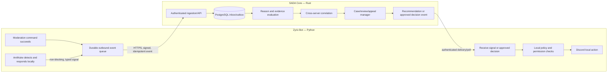

> **Repository scope:** Proposed design only. SADA contains no Zyrix Bot source. Any bot/ paths below describe an earlier Zyrix&Dash assessment and must be revalidated against the target revision before implementation.

# 02 — System architecture

**Status: proposed technical specification; not implemented.**

## Prior Zyrix source checkout assessment — revalidate before implementation

The earlier Zyrix&Dash source assessment inspected a monorepo checkout with the Python bot in bot/. It described an AutoShardedBot with a single configured shard in core/zyrix.py and explicit cog registration through bot/cogs/__init__.py. These observations are historical and must be revalidated against the implementation revision. That file imports and adds AntiNuke, moderation, Logging, and owner command cogs. The bot embeds an optional FastAPI application in main.py. Feature state is spread across SQLite databases and JSON files; there is no general database migration or case-management layer.

Current moderation integration points:

- bot/cogs/moderation/warn.py increments db/warn.db table warns(guild_id, user_id, warns). It does not store the original reason, moderator, timestamp, evidence, or a stable case ID. The warn command adds the count and then attempts a DM and response.
- bot/cogs/moderation/ban.py, kick.py, timeout.py, unban.py and the larger moderation cog execute local Discord operations. Their callbacks/decorators are the safest first integration points for confirmed local actions, after the Discord API returns success.
- bot/cogs/commands/logging.py listens to member/role/channel events, fetches recent audit entries, and sends embeds to configured channels. Its configuration is JSON and it is a log display, not a structured incident service. Audit lookups are cached for 10 seconds and may not always identify an actor.
- bot/cogs/antinuke/ contains listeners for bans, kicks, prunes, bot additions, channel/role changes, integrations, and webhooks. These cogs are instantiated in bot/cogs/__init__.py. They consult local db/anti.db settings and whitelists and some take direct local action.
- bot/cogs/commands/owner2.py contains global GB and global kick owner commands. They iterate mutual guilds and execute directly; SADA must remain a separate path.

## Proposed independent components

### Zyrix Bot adapter (Python)

- Capture a bounded structured event after an existing moderation command succeeds.
- Optionally submit explicitly approved Antinuke security events as a distinct event type and confidence level.
- Queue outgoing event payloads durably so service downtime does not block local moderation.
- Authenticate to SADA, retry idempotently, and surface dead-letter/authorization errors to operators without logging secrets.
- Receive candidate signals or an approved global decision event.
- Decide locally whether the guild opted into the relevant behavior and independently check user membership, moderator permission, bot permission, hierarchy, and current case/revocation state.
- Execute only local Discord actions. It never trusts a remote “ban now” string as authorization.

### SADA Core (Rust)

- Authenticate installations and validate event schemas, identity, size, timestamp, and idempotency.
- Keep original reasons intact in restricted storage while producing separate normalized categories with classifier/version/confidence metadata.
- Evaluate evidence quality and source-server reliability proportionally.
- Correlate events by user, reason category, source independence, evidence quality, time window, and corrections.
- Create explainable suspicious signals and cases; the scoring function has no Discord write access.
- Provide case management, global-review workflow, appeals/corrections, and approved decision signals.
- Publish per-case signals to authorized Zyrix Bot instances. Record acknowledgments and outcomes as separate states.

### Persistence and work queue

Recommended production core: PostgreSQL for structured incidents, cases, reviewer votes, guild participation, enforcement receipts, and append-only audit records. Its relational constraints and transactions fit idempotent cross-service writes and concurrent review. Store sensitive original reasons encrypted at rest with access audit and retention controls. Do not share a SQLite file between bot installations.

Start with PostgreSQL-backed inbox/outbox/job tables and a Rust worker for asynchronous classification, retries, scheduled rechecks, and notification fanout. This avoids deploying a separate broker before volume requires one. Add NATS only when measured throughput, multiple independent consumers, or delivery-isolation requirements justify the operational cost. Redis is optional for short-lived rate limits/cache only; it must not be the only copy of an incident or approval. **OPEN DECISION:** whether initial production needs a queue broker or the PostgreSQL job table is sufficient.

## Event data flow

## Structured event contract

Use a versioned schema and separate event type from evidentiary status. Minimum fields: schema_version; event_id/idempotency_key; installation_id; source_guild_id; subject_user_id; event_type; local_action; occurred_at; received_at; actor_user_id or actor_kind; original_reason; optional reason_category_claims; reason_source; evidence references/IDs; audit_entry_id if available; local_action_result; confidence/verification state; source_component (moderation, antinuke, audit import); and data-sharing policy version.

The event must explicitly say whether it is a confirmed moderation action, a suspicious Antinuke signal, an audit observation, or an unverified report. An AntiNuke event is not automatically a verified user misconduct incident. Do not include private message bodies, bot tokens, webhook URLs, or unrelated member data. Limit and sanitize fields at both boundaries.

## Communication, reliability, and monitoring

Use HTTPS/TLS and installation-scoped credentials (prefer mTLS service identity where deployment supports it, otherwise signed short-lived requests with key rotation). Sign canonical request bodies; include timestamp, event ID, and replay nonce/window. SADA validates installation identity, schema, source-guild authorization, consent version, and idempotency before accepting. Responses/events are authenticated too. Never expose the Discord bot token to SADA.

The bot uses a durable outbox, exponential backoff with jitter, bounded retries, idempotency keys, and dead-letter visibility. SADA uses an inbox uniqueness constraint, transactional job enqueue, retry state, and dead-letter records. Failed SADA delivery never delays/rolls back a completed local moderation action. Failed recommendation delivery never authorizes local enforcement. Both systems expose liveness and readiness; readiness requires the database and worker state necessary for that service, not Discord API health alone. Monitor queue age, duplicate rate, database availability, classification failures, review backlog, delivery/ack failures, per-guild enforcement results, and source-quality drift without logging secrets.

## Simplest scalable recommendation

Use one independent Rust SADA API/worker deployment plus PostgreSQL, with the existing Python bot as the Discord adapter. PostgreSQL-backed jobs/outbox are enough initially; add NATS or Redis only after traffic or multi-consumer requirements are measured. Deploy and scale SADA independently. SADA failure disables only cross-server intelligence functions; bot commands, local moderation, and AntiNuke continue normally.
