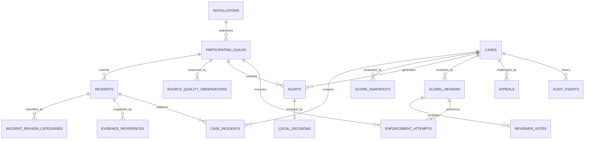

# 06 — Database and data model

**Status: proposed technical specification; not implemented.**

## Storage recommendation

A prior Zyrix&Dash source assessment found multiple feature-owned SQLite databases and JSON files, with no general migration framework; revalidate this before implementation. Do not modify those stores to become SADA's case ledger. The independent SADA service should use PostgreSQL as the authoritative structured store: multiple bot installations and review workers need concurrent writes, transactions, uniqueness constraints, relational audit links, and safe job processing. Do not share a SQLite file over a network filesystem. PostgreSQL is a proposed future dependency; no database or migration is created in this task.

Store timestamps in UTC, Discord snowflakes consistently as BIGINT or canonical decimal strings, and opaque UUIDs for incident/case/decision IDs. Enforce foreign keys and CHECK constraints. Use transaction boundaries for event intake, case evidence, state transitions, audit events, and outbox jobs. Encrypt sensitive reason fields at rest and restrict access. Never store bot tokens in this database.

## Proposed entities

Types below use PostgreSQL notation. Every field is proposed, and production DDL requires owner-approved retention/privacy policy.

### schema_migrations

- Purpose: explicit SADA schema version tracking.
- Fields: version INTEGER primary key; applied_at TIMESTAMPTZ not null; checksum TEXT not null.
- Constraints/indexes: primary key; no automatic database reset on mismatch.
- Retention: permanent.

### installations

- Purpose: identify a Zyrix Bot deployment authorized to submit events and receive signals.
- Fields: installation_id UUID primary key; display_name TEXT; credential_key_id TEXT; state ENUM(active, paused, revoked); created_at; last_seen_at; schema_version; allowed_guild_ids or server authorization reference; credential_rotated_at.
- Indexes: state, last_seen_at.
- Rules: secret material is stored in a secret manager, not plaintext rows; revocation immediately rejects new events.
- Retention: retain security audit metadata after revocation, subject to approved policy.

### participating_guilds

- Purpose: explicit per-guild consent and controls for a source/recipient server.
- Fields: guild_id BIGINT primary key; installation_id UUID FK; state ENUM(off, active, paused, left, suspended); share_incidents BOOLEAN; receive_intelligence BOOLEAN; local_alerts BOOLEAN; global_enforcement BOOLEAN; alert_channel_id BIGINT nullable; consent_version TEXT; configured_by_user_id BIGINT; configured_at TIMESTAMPTZ; paused_at; left_at; policy_version TEXT; updated_at.
- Indexes: installation_id/state; global_enforcement/state.
- Rules: all controls default false; enforcement true requires active participation, explicit actor/time, and an audit event. Guild owner/admin can only configure its own row.
- Retention: leaving stops new flow; preserve minimal audit/history as approved; deletion procedure must not erase linked review history silently.

### incidents

- Purpose: original source report/action plus provenance and verification lifecycle.
- Fields: incident_id UUID primary key; idempotency_key TEXT unique not null; source_guild_id BIGINT FK; installation_id UUID FK; target_user_id BIGINT not null; action_type ENUM(warn, timeout, mute, kick, ban, unban, antinuke_signal, other_approved); original_reason TEXT nullable; occurred_at TIMESTAMPTZ; received_at TIMESTAMPTZ; actor_user_id BIGINT nullable; actor_kind TEXT; source_component TEXT; source_event_id TEXT nullable; audit_entry_id TEXT nullable; evidence_status ENUM(unverified, verified, reviewed, disputed, reversed); verification_method TEXT; quality_snapshot JSONB; corrected_by UUID nullable FK incidents; consent_version TEXT; retention_until TIMESTAMPTZ nullable.
- Indexes: (target_user_id, occurred_at); (source_guild_id, occurred_at); (evidence_status, occurred_at); (source_guild_id, source_component, source_event_id) unique when source_event_id is non-null.
- Rules: verified describes event provenance, not guilt. Original reason is preserved and access-controlled; a later corrected reason is a new version/audit event. Limit length, encrypt at rest, redact secrets/private data under a documented policy.
- Retention: **OPEN DECISION** per evidence class and appeal/legal hold. Reversed rows remain in audit history but are excluded from active support.

### incident_reason_categories

- Purpose: many-to-many normalized category proposals/reviews without overwriting original reason.
- Fields: category_record_id UUID primary key; incident_id UUID FK; category ENUM(phishing_scam, malware_link, coordinated_raid, harassment_targeted, repeated_spam, advertising, personal_dispute, unknown); classification_source ENUM(rule, model, human); classifier_version TEXT nullable; confidence NUMERIC(4,3); review_state ENUM(proposed, confirmed, rejected, disputed, reversed); reviewer_user_id BIGINT nullable; reviewed_at TIMESTAMPTZ nullable; reviewer_reason TEXT nullable; created_at.
- Constraints/indexes: unique (incident_id, category_record_id); indexes category/review_state, incident_id.
- Rules: unreviewed classifier labels are hypotheses. Reviewer changes append revisions; do not convert sentiment/opinion terms into fact silently.
- Retention: same as incident, with restricted reviewer notes.

### evidence_refs

- Purpose: auditable references to supporting material without copying private content by default.
- Fields: evidence_id UUID primary key; incident_id UUID FK; evidence_type TEXT; source_ref TEXT nullable (audit ID/message ID/case reference); evidence_hash TEXT nullable; captured_at; access_scope; quality_code; redacted_summary TEXT nullable; retention_until.
- Indexes: incident_id, evidence_type.
- Rules: allowlist reference types; no arbitrary URL fetch by the bot; validate/sanitize references; access check before rendering.
- Retention: explicit policy; expire external references when source data is deleted.

### source_quality_observations

- Purpose: transparent measurements of source evidence quality over time.
- Fields: observation_id UUID primary key; source_guild_id BIGINT FK; window_start/window_end TIMESTAMPTZ; completeness_rate NUMERIC; audit_consistency_rate NUMERIC; duplicate_rate NUMERIC; correction_rate NUMERIC; reviewed_supported_count INTEGER; unsupported_count INTEGER; denominator INTEGER; confidence_level TEXT; reasons JSONB; computed_at; methodology_version.
- Indexes: (source_guild_id, window_end); methodology_version.
- Rules: include denominator and confidence; low volume means insufficient data. Appeals alone are not a penalty. Observations can trigger human review/caps but do not silently ban or erase source events.
- Retention: retain aggregate measurements per approved period; source-level raw input obeys incident policy.

### cases

- Purpose: reviewable suspicious signal for one target and evidence window/category cluster.
- Fields: case_id UUID primary key; target_user_id BIGINT; status ENUM(candidate, open, in_review, approved, rejected, on_hold, revoked, closed); created_at; updated_at; closed_at; policy_version; scorer_version; evidence_window_start/end; explanation JSONB; current_score_id UUID nullable FK; appeal_hold BOOLEAN; reopened_from UUID nullable FK cases.
- Indexes: target_user_id/status; status/updated_at; created_at.
- Constraints: partial unique index can allow one active case per target/category/window according to policy.
- Rules: score is a recommendation only. Preserve each evidence snapshot and explanation. Reopen as linked version or audited transition.
- Retention: **OPEN DECISION**; minimize personal data while preserving decisions and appeal history.

### case_links

- Purpose: evidence snapshot membership for a case.
- Fields: case_id UUID FK; incident_id UUID FK; inclusion_status ENUM(included, excluded, disputed); inclusion_reason TEXT; included_at; PRIMARY KEY(case_id, incident_id).
- Indexes: incident_id, inclusion_status.
- Rules: status changes are audited; never delete association to hide excluded evidence.
- Retention: same as case/incident policy.

### score_snapshots

- Purpose: immutable, explainable scoring output.
- Fields: score_id UUID primary key; case_id UUID FK; target_user_id BIGINT; category; calculated_at; window_start/end; scorer_version; policy_version; total_score NUMERIC; distinct_guild_count INTEGER; breakdown JSONB; included_incident_ids JSONB; excluded_incident_ids JSONB; confidence_summary JSONB.
- Indexes: target_user_id/calculated_at; case_id/calculated_at.
- Rules: snapshot identifies exactly which incident and category revisions were considered. A score cannot trigger a Discord write.
- Retention: while case is active and through approved audit period.

### alerts

- Purpose: one alert version per case and recipient guild.
- Fields: alert_id UUID primary key; case_id UUID FK; guild_id BIGINT FK; target_user_id BIGINT; evidence_fingerprint TEXT; status ENUM(pending, delivered, ignored, locally_banned, expired, delivery_failed, superseded); channel_id BIGINT nullable; message_id BIGINT nullable; created_at; delivered_at; attempts INTEGER; retry_at; error_code; supersedes_alert_id UUID nullable FK.
- Constraints/indexes: unique(case_id, guild_id, evidence_fingerprint); (guild_id, status, created_at); unique(channel_id, message_id) when set.
- Rules: member must be confirmed present before delivery. Ignore does not suppress materially new evidence if approved reopen policy creates a linked alert.
- Retention: keep delivery/outcome history per policy.

### local_decisions

- Purpose: per-guild Ban User or Ignore choice.
- Fields: decision_id UUID primary key; alert_id UUID unique FK; guild_id BIGINT FK; target_user_id BIGINT; actor_user_id BIGINT; decision ENUM(ban, ignore); decided_at; reason nullable; action_status; discord_audit_id nullable; idempotency_key TEXT unique.
- Indexes: guild_id/decided_at; actor_user_id/decided_at.
- Rules: Ban is local only; repeated click returns same record. Ignore is not a global rejection.
- Retention: durable through approved moderation audit period.

### global_reviews and reviewer_votes

- Purpose: distinguish proposal, individual reviewer votes, and final global decision.
- global_reviews fields: review_id UUID primary key; case_id UUID FK; status ENUM(pending, approved, rejected, on_hold, revoked); proposed_by BIGINT; proposed_at; closed_at; policy_version; score_id UUID FK; evidence_snapshot_hash; required_quorum INTEGER; rationale TEXT.
- reviewer_votes fields: vote_id UUID primary key; review_id UUID FK; reviewer_user_id BIGINT; vote ENUM(approve, reject, request_info, withdraw); reason TEXT; decided_at; authorization_source; vote_revision INTEGER.
- Indexes: review case/status; vote reviewer/time; unique final vote per reviewer/review or explicit revision numbering.
- Rules: verify reviewer authority at action time; quorum and separation of duties are open decisions. Every decision binds to the evidence snapshot.
- Retention: durable case audit.

### enforcement_attempts

- Purpose: one guild-specific attempt/result for one approved review.
- Fields: enforcement_id UUID primary key; review_id UUID FK; guild_id BIGINT FK; target_user_id BIGINT; policy_version; status ENUM(queued, skipped_opt_out, skipped_absent, skipped_unknown, skipped_already_banned, skipped_permission, skipped_hierarchy, succeeded, failed, outcome_unknown, reversal_pending, reversed, reversal_failed); attempts INTEGER; started_at; completed_at; result_code; discord_audit_id nullable; idempotency_key TEXT unique; previous_ban_state; bot_ack_id nullable.
- Constraints/indexes: unique(review_id, guild_id, policy_version); guild_id/status; target_user_id/status.
- Rules: store success/failed/skipped/unavailable independently. Reconcile unknown before retry. Never imply all-guild success from a partial result.
- Retention: durable.

### appeals, audit_events, and delivery_outbox

- appeals: appeal_id UUID PK; case_id FK; appellant_user_id; statement encrypted/restricted; status; submitted_at; assigned_reviewer_id; resolution; resolved_at; reason. Index case/status and appellant/time. Retention is an **OPEN DECISION**.
- audit_events: event_id UUID PK; object_type/id; actor_user_id/type; action; timestamp; reason; before/after state; policy/evidence version; request_id; outcome. Append-only; indexes object/time and actor/time. Never log credentials or private chat content.
- delivery_outbox: job_id UUID PK; installation_id; job_type; idempotency_key unique; payload_ref; status; attempts; next_attempt_at; last_error_code; created_at/completed_at. Index status/next_attempt_at. Keep payload encrypted/minimized and purge per retention.

## Relationships

## Transaction and idempotency rules

- Validate schema, consent, IDs, timestamps, text limits and event type before persistence.
- Enforce unique event/idempotency keys. Retry returns the original event/result; it never increases score.
- Commit incident, category proposal, evidence references, case links, and audit entry transactionally where possible.
- Use the PostgreSQL inbox/outbox for cross-service side effects. Discord HTTP operations cannot share a DB transaction: persist intent first, call through Zyrix Bot, then record receipt.
- Use conditional state transitions and unique per-case/guild keys to prevent concurrent duplicate alerts/actions.
- Do not cascade-delete case history. Retention and correction are explicit audited workflows.
- Backup, restore, migration tooling, encryption-key lifecycle and deletion policy must be approved before production data collection.
