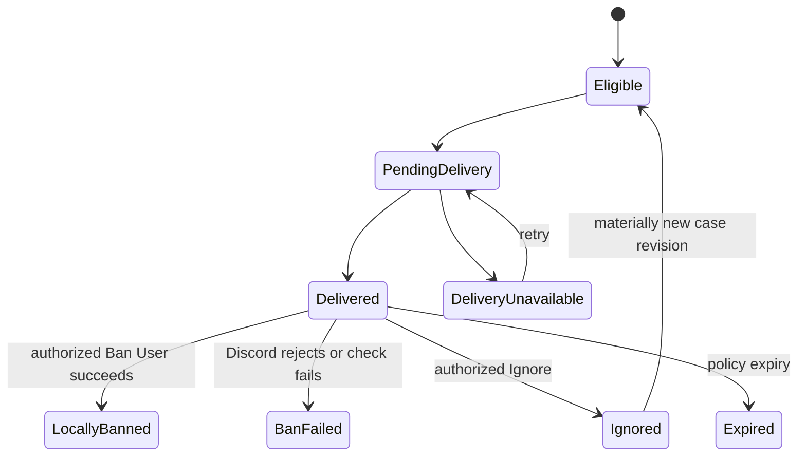

# Alerts and Interactive Controls

## Delivery eligibility

SADA alerts are guild-specific. Before creating or delivering one, Zyrix Bot checks that the target is currently in that guild. Do not notify every server owner or DM administrators. If membership cannot be determined reliably, mark delivery as unavailable and retry or leave it for staff review; do not assume membership.

An alert is sent only when the guild explicitly opted into SADA alerts and the case meets the configured alert policy. Collection, intelligence receipt, alerts, and global enforcement are separate participation switches. All are off by default until an administrator chooses otherwise.

## Alert contents

The alert should present:

- Discord identity and immutable user ID, with uncertainty where account identity metadata is unavailable.
- Unique SADA case ID and case revision.
- Original reported reasons, preserving source wording and attribution.
- Normalized threat categories separately from original reasons.
- Counts by incident type and evidence status; do not collapse warnings into bans.
- Reporting server identities only to the extent allowed by the privacy policy.
- Evidence quality and reviewer status, including disputed, reversed, or unverified items.
- A short explanation that a SADA flag is a lead for local review, not proof or an automatic global ban.
- Exactly two primary buttons: **Ban User** and **Ignore**.

Do not attach raw private messages, credentials, or unredacted evidence by default. Provide secure staff-only case access if later approved.

## Ban User

This control requests a local decision only. On click, Zyrix Bot rechecks actor authorization, target membership, bot permission, role hierarchy, guild opt-in, case revision, and whether the action is still available. It then calls Discord's guild ban operation and records the result. A global case status is unchanged. If Discord rejects the action, show a failure and record a failed local attempt; never display a success message.

## Ignore

Ignore stores guild ID, alert ID/revision, actor ID, timestamp, and optional reason. It suppresses redelivery of the same unresolved revision to that guild according to configured delivery behavior. It does not remove incidents, alter case evidence, or affect other guilds.

Materially new evidence can create a new case revision and make the case eligible for a renewed alert. Define what qualifies as material (for example, a newly verified severe incident or a reviewer status change) before implementation. Thresholds and reopening policy remain configurable or owner-approved **OPEN DECISIONS**.

## Deduplication and delivery

Use a unique key for `(guild_id, case_id, case_revision, alert_type)` and an outbox record so retries cannot create duplicate logical alerts. Message delivery can still be uncertain if Discord accepted a message but the response was lost; store the message ID when known and reconcile retries without repeatedly posting. Apply per-guild rate limits and group low-priority updates where appropriate.

## Alert lifecycle

An unavailable or failed delivery is not an ignored alert. A failed ban does not transition the case to globally banned.
