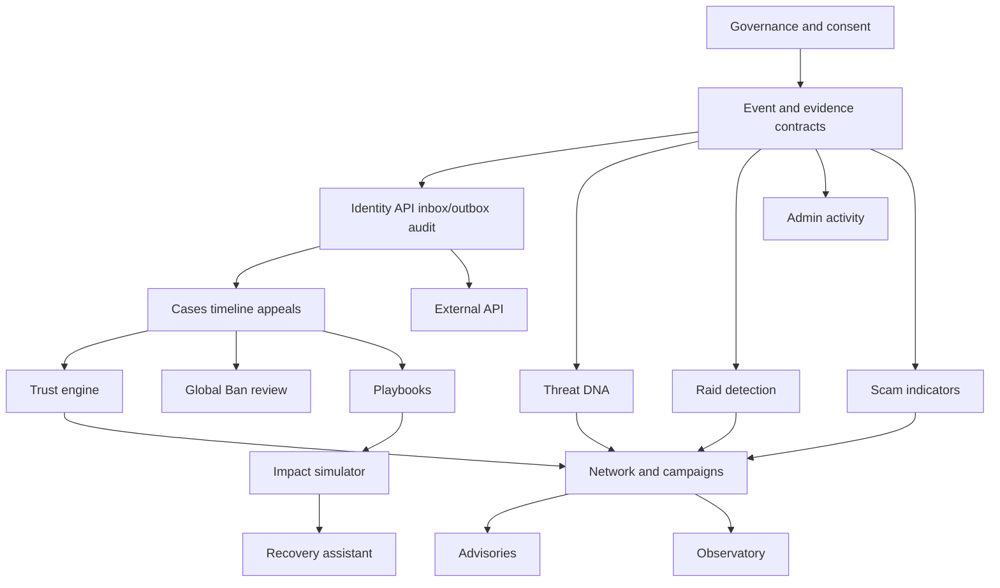

# 02 — Feature dependencies

All features require consent, tenant auth, provenance, audit, idempotency, corrections, retention and operations. Global Ban depends on appeals/trust/review governance; scam analysis on isolated egress; recovery on simulation/owner approval; ban evasion on legal review; public surfaces on aggregation privacy.
