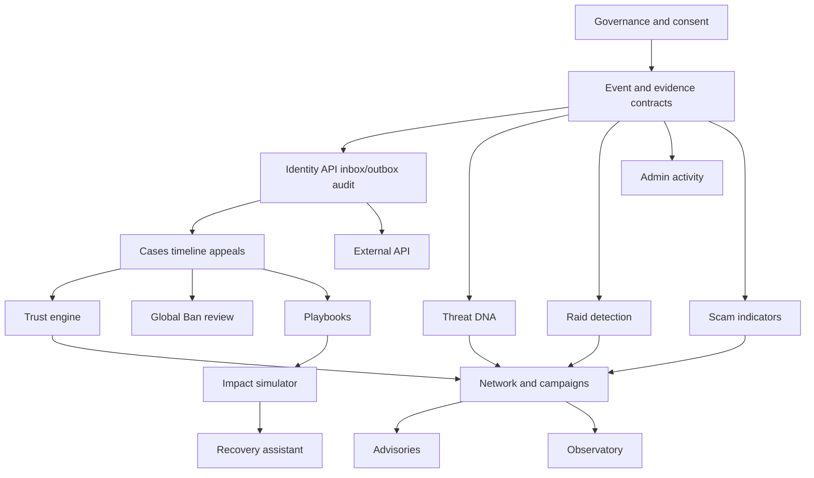
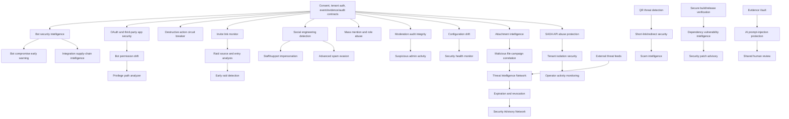

# 02 — Feature dependencies

All features require consent, tenant auth, provenance, audit, idempotency, corrections, retention and operations. Global Ban depends on appeals/trust/review governance; scam analysis on isolated egress; recovery on simulation/owner approval; ban evasion on legal review; public surfaces on aggregation privacy.

## Additional module dependencies

Specific boundaries: bot intelligence is a domain projection on the shared threat graph; bot compromise analyzes bot behavior while Suspicious Admin Activity focuses human administrative events. Invite monitoring owns invite lifecycle facts; Early Raid Detection owns local rates; Raid Source Analysis owns attribution state. Social Engineering classifies interaction tactics; Scam Intelligence owns URL/domain reputation. Configuration Drift owns change deltas and baselines; Health Monitor owns point-in-time assessment. Attachment Intelligence owns file observations/scanner facts; File Campaign Correlation groups them. External feeds ingest provenance; shared Threat Intelligence owns cross-domain relationships. Expiration/revocation controls indicator lifecycle; Evidence Vault controls artifact retention. API Abuse uses shared authentication; Tenant Isolation tests/enforces authorization across modules. Operator Monitoring projects the shared audit ledger. AI adds optional guarded recommendations to existing case review and never owns decisions.
