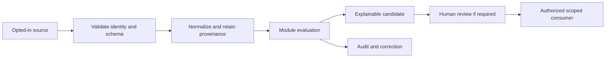

# Incident Recovery Assistant

**Status: proposed architecture; documentation only.** This module is not implemented or deployed.

## Purpose and problems solved

Prepare reviewable restoration plans from captured guild config after destructive incidents. It receives Versioned config snapshot, live state, approved scope, owner authorization. It produces Diff and plan with dependencies, unsupported items, approvals, receipts, rollback limits.

## What it does

- Capture, compare, plan, simulate, owner approves, Zyrix executes bounded steps, reconcile.
- Keeps source observations, derived assessment, human decision, and local action result distinct.
- Versions rules and identifies inputs, exclusions, limitations, and reviewer state.

## What it must never do

Never restore automatically, bypass hierarchy, claim deleted Discord IDs are identical or full rollback.

## Main workflow

Capture, compare, plan, simulate, owner approves, Zyrix executes bounded steps, reconcile.

## Data and API boundaries

Proposed module projections: configuration_snapshots, recovery_plans, recovery_steps, approvals, execution_receipts. Canonical events, incidents, evidence, cases and audit are defined once in [platform data architecture](../system-architecture/05-database-and-storage-architecture.md) and [shared standards](../shared-standards/README.md). Store typed references instead of duplicating source records. API conventions are shared with [Threat Intelligence API](../threat-intelligence-api/README.md).

## Security and privacy

Risks include Stale backup, injected snapshot, escalation, name collisions, partial execution. Enforce least privilege, opt-in, minimization, audited sensitive reads, bounded inputs, explicit retention, scoped summaries, and fail-closed authorization. On dependency outage, expose unavailable/stale status; never turn missing data into clean findings or action authority. Retries use [idempotent delivery](../shared-standards/07-idempotency-and-delivery-standard.md).

## Dependencies and integration

Incident Recovery Assistant connects with:
- [Security Health Monitor](../security-health-monitor/README.md)
- [Evidence Vault](../evidence-vault/README.md)
- [Attack Impact Simulator](../attack-impact-simulator/README.md)
- [Emergency Response Playbooks](../emergency-response-playbooks/README.md)
- [Incident Timeline](../incident-timeline/README.md)

Cross-module records use stable event, incident, evidence, case, campaign and correlation IDs. The source context owns original evidence.

## Testing and acceptance

Use synthetic fixtures, deterministic clocks, disposable PostgreSQL, fake service identities and Discord API stubs. Primary invariant: Unrestorable IDs surfaced; interruption reconciles state before retry. Also test tenant isolation, duplicate/revoked events, corrections, migration rollback, restart recovery and absence of forbidden fields in logs. No live Discord action or accuracy claim.

## Implementation phase

**Proposed phase:** 6 after integrity/simulator. Prerequisites include shared contracts, identity, consent, retention, audit, and outbox. See [platform roadmap](../implementation-roadmap/README.md).

## Open decisions

Snapshot cadence; restorable objects; owner verification; retention. Thresholds, retention and authority rules remain unresolved until approved and versioned.

## Data model appendix

[Module-owned PostgreSQL tables, keys, indexes, and retention notes](data-model.md).

## Document index

| # | Document | Purpose |
|---|---|---|
| 01 | [Overview and objectives](01-overview-and-objectives.md) | Contract, safeguards and implementation gate for overview and objectives. |
| 02 | [Recovery architecture](02-recovery-architecture.md) | Contract, safeguards and implementation gate for recovery architecture. |
| 03 | [Configuration snapshots](03-configuration-snapshots.md) | Contract, safeguards and implementation gate for configuration snapshots. |
| 04 | [Role and channel reconstruction](04-role-and-channel-reconstruction.md) | Contract, safeguards and implementation gate for role and channel reconstruction. |
| 05 | [Permission restoration](05-permission-restoration.md) | Contract, safeguards and implementation gate for permission restoration. |
| 06 | [Owner authorization and safety](06-owner-authorization-and-safety.md) | Contract, safeguards and implementation gate for owner authorization and safety. |
| 07 | [Rollback and audit](07-rollback-and-audit.md) | Contract, safeguards and implementation gate for rollback and audit. |
| 08 | [Testing and acceptance criteria](08-testing-and-acceptance-criteria.md) | Contract, safeguards and implementation gate for testing and acceptance criteria. |
| 09 | [Implementation roadmap](09-implementation-roadmap.md) | Contract, safeguards and implementation gate for implementation roadmap. |
