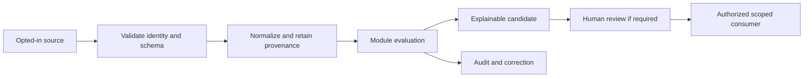

# Incident Timeline

**Status: proposed architecture; documentation only.** This module is not implemented or deployed.

## Purpose and problems solved

Provide chronology that distinguishes source time, receipt time, attribution confidence, and correction. It receives Typed events, occurred/observed/received times, source refs, revisions and case/campaign links. It produces Case/campaign timeline with ordering uncertainty and provenance.

## What it does

- Persist immutable event, normalize time, order with tie-breakers, annotate uncertainty, append corrections, rebuild view.
- Keeps source observations, derived assessment, human decision, and local action result distinct.
- Versions rules and identifies inputs, exclusions, limitations, and reviewer state.

## What it must never do

Never overwrite source or hide clock uncertainty; order is not proof.

## Main workflow

Persist immutable event, normalize time, order with tie-breakers, annotate uncertainty, append corrections, rebuild view.

## Data and API boundaries

Proposed module projections: events, timeline_links, correction_events, source_refs, audit_events. Canonical events, incidents, evidence, cases and audit are defined once in [platform data architecture](../system-architecture/05-database-and-storage-architecture.md) and [shared standards](../shared-standards/README.md). Store typed references instead of duplicating source records. API conventions are shared with [Threat Intelligence API](../threat-intelligence-api/README.md).

## Security and privacy

Risks include Clock skew, forged time, floods, unauthorized discovery. Enforce least privilege, opt-in, minimization, audited sensitive reads, bounded inputs, explicit retention, scoped summaries, and fail-closed authorization. On dependency outage, expose unavailable/stale status; never turn missing data into clean findings or action authority. Retries use [idempotent delivery](../shared-standards/07-idempotency-and-delivery-standard.md).

## Dependencies and integration

Incident Timeline connects with:
- [Evidence Vault](../evidence-vault/README.md)
- [Attack Campaign Tracker](../attack-campaign-tracker/README.md)
- [Threat Intelligence Network](../threat-intelligence-network/README.md)
- [Security Observatory](../security-observatory/README.md)

Cross-module records use stable event, incident, evidence, case, campaign and correlation IDs. The source context owns original evidence.

## Testing and acceptance

Use synthetic fixtures, deterministic clocks, disposable PostgreSQL, fake service identities and Discord API stubs. Primary invariant: Late event appears at source time with late-received marker; correction links original. Also test tenant isolation, duplicate/revoked events, corrections, migration rollback, restart recovery and absence of forbidden fields in logs. No live Discord action or accuracy claim.

## Implementation phase

**Proposed phase:** 1 shared foundation. Prerequisites include shared contracts, identity, consent, retention, audit, and outbox. See [platform roadmap](../implementation-roadmap/README.md).

## Open decisions

Retention; cross-case view; time precision. Thresholds, retention and authority rules remain unresolved until approved and versioned.

## Data model appendix

[Module-owned PostgreSQL tables, keys, indexes, and retention notes](data-model.md).

## Document index

| # | Document | Purpose |
|---|---|---|
| 01 | [Overview and objectives](01-overview-and-objectives.md) | Contract, safeguards and implementation gate for overview and objectives. |
| 02 | [Event and timeline architecture](02-event-and-timeline-architecture.md) | Contract, safeguards and implementation gate for event and timeline architecture. |
| 03 | [Event ordering and correlation](03-event-ordering-and-correlation.md) | Contract, safeguards and implementation gate for event ordering and correlation. |
| 04 | [Evidence and source attribution](04-evidence-and-source-attribution.md) | Contract, safeguards and implementation gate for evidence and source attribution. |
| 05 | [Case and campaign timelines](05-case-and-campaign-timelines.md) | Contract, safeguards and implementation gate for case and campaign timelines. |
| 06 | [Access control and privacy](06-access-control-and-privacy.md) | Contract, safeguards and implementation gate for access control and privacy. |
| 07 | [Testing and acceptance criteria](07-testing-and-acceptance-criteria.md) | Contract, safeguards and implementation gate for testing and acceptance criteria. |
| 08 | [Implementation roadmap](08-implementation-roadmap.md) | Contract, safeguards and implementation gate for implementation roadmap. |
