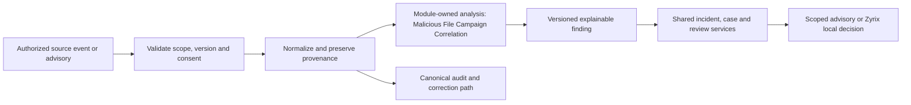

# Malicious File Campaign Correlation

**Catalogue module 39 of 49. Status: proposed specification only; not implemented or deployed.**

## Purpose

Group related attachment observations into expiring, explainable malware campaign candidates.

## What it does

Normalize file indicator; deduplicate exact hash; link source observations with typed relations; compute independent-guild counts; create campaign candidate; propagate correction/expiry.

## What it must never do

- It must not execute Discord moderation or configuration changes. Zyrix Bot remains the only Discord action boundary and rechecks local consent, permissions and role hierarchy.
- It must not treat a score, anomaly or single report as proof or punishment authority.
- It must not bypass guild opt-in, shared case/review, evidence, identity or audit contracts.

## Signals and workflow

**Inputs:** Exact file hashes; safe metadata; scanner/advisory provenance; time buckets; reviewed attachment observations.



Exact hash matches can link identical bytes; metadata similarity is a weaker edge requiring separate explanation and review. Each indicator has valid-from/expiry and revocation state.

## Ownership and integration

This module owns only domain-specific observations, snapshots, assessments and indicator references. It reuses canonical installation/consent, event inbox, incident/evidence, case/review, delivery/outbox and audit records. It does not create separate authentication, case management, evidence vault, reviewer quorum or audit systems.

Dependencies: [Malicious Attachment Intelligence](../malicious-attachment-intelligence/README.md), [Threat Intelligence Network](../threat-intelligence-network/README.md), [Attack Campaign Tracker](../attack-campaign-tracker/README.md), Threat Intelligence Expiration and Revocation..

## Security, privacy and limitations

Share only approved hashes and minimal metadata; prevent lookup oracle enumeration; enforce expiry and correction propagation. No fuzzy identity claims from filenames alone; hash collision and repackaging limitations are visible; no automatic file deletion.

Cross-guild sharing requires explicit purpose and permission. Missing, stale or inaccessible data is represented as unknown/partial. Corrections and revocations are versioned and propagate to pending deliveries.

## API and event contract

**Method:** `POST`. Proposed internal endpoint: `POST /v1/file-campaign/observations`. It uses the shared `/v1` authentication and authorization model, guild scope from authenticated grants, request ID, schema version, idempotency key, bounded JSON payload, and shared error shape. The endpoint accepts observations or recommendations only; it does not execute Discord actions. A durable inbox receipt is returned only after commit. Duplicate key + same canonical body returns the original receipt; changed body returns `409`. Retry only transient `retryable=true` errors.

Example request:
```json
{
  "schema_version": "1.0",
  "event_id": "018f0000-0000-7000-8000-000000000001",
  "source_guild_id": "123456789012345678",
  "occurred_at": "2026-11-16T10:00:00Z",
  "consent_version": "guild-consent-7",
  "correlation_id": "018f0000-0000-7000-8000-000000000003",
  "payload": { "observation_ref": "opaque-reference", "type": "module-specific" }
}
```

Example accepted response:
```json
{"event_id":"018f0000-0000-7000-8000-000000000001","receipt_id":"018f0000-0000-7000-8000-000000000004","status":"accepted","duplicate":false}
```

## Data model

See [module data model](data-model.md). Tables below are proposals only; canonical IDs and shared ownership follow [platform storage architecture](../system-architecture/05-database-and-storage-architecture.md). Retention and access remain subject to the platform policy register.

## Design status and implementation phase

**Current status:** architecture proposal. **Proposed phase:** Phase 6 after attachment indicator governance. No runtime behavior or algorithm has been validated. Resolve before implementation: Hash algorithms and cross-server visibility tiers need decision.

## Documents

- [01 Overview and objectives](01-overview-and-objectives.md)
- [02 System architecture](02-system-architecture.md)
- [03 Feature workflow](03-feature-workflow.md)
- [04 Detection and contract details](04-detection-and-contract-details.md)
- [data-model.md](data-model.md)
- [05 Security and abuse prevention](05-security-and-abuse-prevention.md)
- [06 Testing and acceptance criteria](06-testing-and-acceptance-criteria.md)
- [07 Implementation roadmap](07-implementation-roadmap.md)
