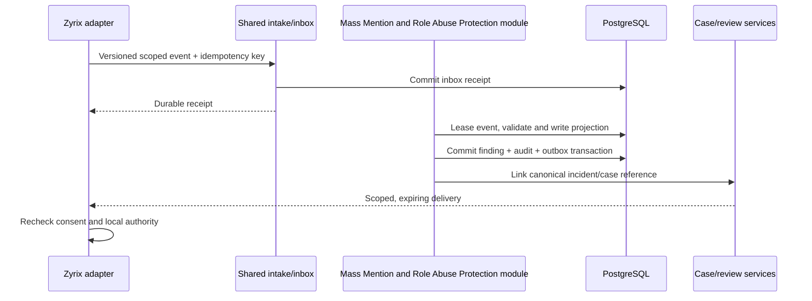

# 02 — System architecture: Mass Mention and Role Abuse Protection

**Proposed design; Rust SADA Core, PostgreSQL authoritative store, Python Zyrix adapter for Discord capture/actions.**

## Responsibilities and boundaries

1. **Zyrix adapter:** observes only events permitted by guild capability; assigns event and idempotency IDs; durably retries; independently performs any local Discord action.
2. **Shared SADA intake:** authenticates the installation, derives guild scope from grants, validates schema/size/consent, and commits the durable inbox before acknowledging.
3. **Mass Mention and Role Abuse Protection domain module:** validates domain fields, creates module-owned projections, computes versioned factors, and emits a shared incident/finding reference or advisory request.
4. **Canonical services:** own identity/consent, incidents, evidence references, case/review, delivery/outbox and append-only audit.
5. **Consumers:** authorized reviewers and adapter receive only scoped summaries; downstream actions require fresh local checks.

Ingest local event features; resolve role risk against approved baseline; compare rate and target breadth with guild policy; alert and propose a local mitigation checklist.

## Trust boundaries and failure handling

Treat event payloads, feed data and attachments as untrusted. No network call occurs inside the state transaction. Unknown schema major version is rejected; duplicate delivery is idempotent; transient dependency errors retry with bounded jitter; poison events dead-letter with a safe reason code. If canonical identity, consent, provenance or evidence state is unavailable, do not create an actionable finding. A stale dependency is shown as stale/unknown, not “safe.”

## Shared contracts

Use UUID IDs, UTC `TIMESTAMPTZ`, canonical decimal Discord snowflakes, versioned payloads, shared confidence/severity vocabulary, append-only corrections, and request/correlation IDs. This module owns only projections described in [data model](data-model.md).
