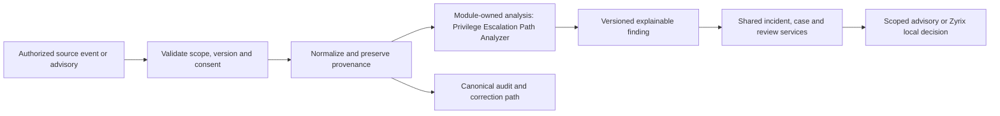

# Privilege Escalation Path Analyzer

**Catalogue module 26 of 49. Status: proposed specification only; not implemented or deployed.**

## Purpose

Explain how role hierarchy and permission combinations can grant or amplify authority.

## What it does

Build guild-scoped permission graph snapshot; identify paths from assignable roles/actors to high-impact permissions; explain edge sequence; provide least-privilege alternatives for human review.

## What it must never do

- It must not execute Discord moderation or configuration changes. Zyrix Bot remains the only Discord action boundary and rechecks local consent, permissions and role hierarchy.
- It must not treat a score, anomaly or single report as proof or punishment authority.
- It must not bypass guild opt-in, shared case/review, evidence, identity or audit contracts.

## Signals and workflow

**Inputs:** Role permission bitsets; role order; member-role assignments; channel overwrites; bot top role; integration grants.



Graph nodes are roles, actors and permissions; edges are can-assign, inherits, channel-override. Evaluate current Discord semantics by a versioned ruleset; mark unknown edges when data is incomplete.

## Ownership and integration

This module owns only domain-specific observations, snapshots, assessments and indicator references. It reuses canonical installation/consent, event inbox, incident/evidence, case/review, delivery/outbox and audit records. It does not create separate authentication, case management, evidence vault, reviewer quorum or audit systems.

Dependencies: [Security Health Monitor](../security-health-monitor/README.md), [Bot Permission Drift Detection](../bot-permission-drift-detection/README.md), [Configuration Drift Detection](../configuration-drift-detection/README.md), OAuth and Third-Party App Security..

## Security, privacy and limitations

No write capability; restrict graph details to guild security admins; redact member lists from recommendations. Graph indicates capability, not intent; cannot account for all external application behavior or future Discord semantic changes.

Cross-guild sharing requires explicit purpose and permission. Missing, stale or inaccessible data is represented as unknown/partial. Corrections and revocations are versioned and propagate to pending deliveries.

## API and event contract

**Method:** `POST`. Proposed internal endpoint: `POST /v1/permission-graphs/analyze`. It uses the shared `/v1` authentication and authorization model, guild scope from authenticated grants, request ID, schema version, idempotency key, bounded JSON payload, and shared error shape. The endpoint accepts observations or recommendations only; it does not execute Discord actions. A durable inbox receipt is returned only after commit. Duplicate key + same canonical body returns the original receipt; changed body returns `409`. Retry only transient `retryable=true` errors.

Example request:

```json
{
  "schema_version": "1.0",
  "event_id": "018f0000-0000-7000-8000-000000000001",
  "source_guild_id": "123456789012345678",
  "occurred_at": "2026-11-16T10:00:00Z",
  "consent_version": "guild-consent-7",
  "correlation_id": "018f0000-0000-7000-8000-000000000003",
  "payload": { "observation_ref": "opaque-reference", "type": "module-specific" }
}
```

Example accepted response:

```json
{"event_id":"018f0000-0000-7000-8000-000000000001","receipt_id":"018f0000-0000-7000-8000-000000000004","status":"accepted","duplicate":false}
```

## Data model

See [module data model](data-model.md). Tables below are proposals only; canonical IDs and shared ownership follow [platform storage architecture](../system-architecture/05-database-and-storage-architecture.md). Retention and access remain subject to the platform policy register.

## Design status and implementation phase

**Current status:** architecture proposal. **Proposed phase:** Phase 4 after role/channel permission snapshot support. No runtime behavior or algorithm has been validated. Resolve before implementation: Supported Discord permission semantics/versioning need implementation-time API verification.

## Documents

- [01 Overview and objectives](01-overview-and-objectives.md)
- [02 System architecture](02-system-architecture.md)
- [03 Feature workflow](03-feature-workflow.md)
- [04 Detection and contract details](04-detection-and-contract-details.md)
- [data-model.md](data-model.md)
- [05 Security and abuse prevention](05-security-and-abuse-prevention.md)
- [06 Testing and acceptance criteria](06-testing-and-acceptance-criteria.md)
- [07 Implementation roadmap](07-implementation-roadmap.md)
