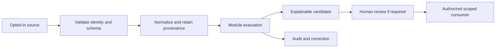

# Scam and Phishing Intelligence

**Status: proposed architecture; documentation only.** This module is not implemented or deployed.

## Purpose and problems solved

Verify and distribute scam indicators while isolating URL analysis from bot infrastructure. It receives Submitted URL/domain, source context, time, isolated redirect chain, provenance. It produces Indicator state, normalized host, evidence refs, confidence, scoped advisory.

## What it does

- Parse safely, normalize IDNA/host, analyze in isolated egress worker, review, distribute, expire/revoke.
- Keeps source observations, derived assessment, human decision, and local action result distinct.
- Versions rules and identifies inputs, exclusions, limitations, and reviewer state.

## What it must never do

Never fetch arbitrary URLs from bot/operator hosts; a report is not proof; reporter hidden by default.

## Main workflow

Parse safely, normalize IDNA/host, analyze in isolated egress worker, review, distribute, expire/revoke.

## Data and API boundaries

Proposed module projections: threat_indicators, indicator_observations, domain_relationships, evidence_refs. Canonical events, incidents, evidence, cases and audit are defined once in [platform data architecture](../system-architecture/05-database-and-storage-architecture.md) and [shared standards](../shared-standards/README.md). Store typed references instead of duplicating source records. API conventions are shared with [Threat Intelligence API](../threat-intelligence-api/README.md).

## Security and privacy

Risks include SSRF, DNS rebinding, private redirect, malware, homographs, stale reputation. Enforce least privilege, opt-in, minimization, audited sensitive reads, bounded inputs, explicit retention, scoped summaries, and fail-closed authorization. On dependency outage, expose unavailable/stale status; never turn missing data into clean findings or action authority. Retries use [idempotent delivery](../shared-standards/07-idempotency-and-delivery-standard.md).

## Dependencies and integration

Scam and Phishing Intelligence connects with:

- [Threat Intelligence Network](../threat-intelligence-network/README.md)
- [Threat DNA](../threat-dna/README.md)
- [Evidence Vault](../evidence-vault/README.md)
- [Trust and Reliability Engine](../trust-and-reliability-engine/README.md)
- [Security Advisory Network](../security-advisory-network/README.md)
- [Incident Timeline](../incident-timeline/README.md)

Cross-module records use stable event, incident, evidence, case, campaign and correlation IDs. The source context owns original evidence.

## Testing and acceptance

Use synthetic fixtures, deterministic clocks, disposable PostgreSQL, fake service identities and Discord API stubs. Primary invariant: Unicode/punycode normalize consistently; private redirects blocked; revocation stops delivery. Also test tenant isolation, duplicate/revoked events, corrections, migration rollback, restart recovery and absence of forbidden fields in logs. No live Discord action or accuracy claim.

## Implementation phase

**Proposed phase:** 3 after isolated analyzer design. Prerequisites include shared contracts, identity, consent, retention, audit, and outbox. See [platform roadmap](../implementation-roadmap/README.md).

## Open decisions

Sandbox; source use; review quorum; expiry; exception authority. Thresholds, retention and authority rules remain unresolved until approved and versioned.

## Data model appendix

[Module-owned PostgreSQL tables, keys, indexes, and retention notes](data-model.md).

## Document index

| # | Document | Purpose |
|---|---|---|
| 01 | [Overview and objectives](01-overview-and-objectives.md) | Contract, safeguards and implementation gate for overview and objectives. |
| 02 | [Threat indicator architecture](02-threat-indicator-architecture.md) | Contract, safeguards and implementation gate for threat indicator architecture. |
| 03 | [URL normalization and analysis](03-url-normalization-and-analysis.md) | Contract, safeguards and implementation gate for url normalization and analysis. |
| 04 | [Domain and redirect analysis](04-domain-and-redirect-analysis.md) | Contract, safeguards and implementation gate for domain and redirect analysis. |
| 05 | [Scam reporting and verification](05-scam-reporting-and-verification.md) | Contract, safeguards and implementation gate for scam reporting and verification. |
| 06 | [Threat reputation and confidence](06-threat-reputation-and-confidence.md) | Contract, safeguards and implementation gate for threat reputation and confidence. |
| 07 | [Trusted domain and exceptions](07-trusted-domain-and-exceptions.md) | Contract, safeguards and implementation gate for trusted domain and exceptions. |
| 08 | [Intelligence distribution](08-intelligence-distribution.md) | Contract, safeguards and implementation gate for intelligence distribution. |
| 09 | [Privacy and security](09-privacy-and-security.md) | Contract, safeguards and implementation gate for privacy and security. |
| 10 | [Testing and acceptance criteria](10-testing-and-acceptance-criteria.md) | Contract, safeguards and implementation gate for testing and acceptance criteria. |
| 11 | [Implementation roadmap](11-implementation-roadmap.md) | Contract, safeguards and implementation gate for implementation roadmap. |
