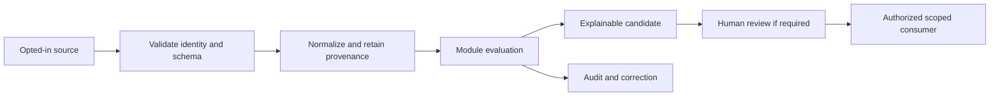

# Security Advisory Network

**Status: proposed architecture; documentation only.** This module is not implemented or deployed.

## Purpose and problems solved

Deliver relevant, deduplicated opt-in notices by subscription and access policy. It receives Reviewed indicator/campaign/case revision, category, severity, confidence, subscription, expiry. It produces Scoped advisory, delivery status, correction/revocation.

## What it does

- Review threat, authorize audience, dedupe revision, enqueue, retry, expire/retract.
- Keeps source observations, derived assessment, human decision, and local action result distinct.
- Versions rules and identifies inputs, exclusions, limitations, and reviewer state.

## What it must never do

No accused-user list, source/evidence leakage, or enforcement implied by subscription.

## Main workflow

Review threat, authorize audience, dedupe revision, enqueue, retry, expire/retract.

## Data and API boundaries

Proposed module projections: advisories, advisory_revisions, subscriptions, delivery_outbox, delivery_receipts. Canonical events, incidents, evidence, cases and audit are defined once in [platform data architecture](../system-architecture/05-database-and-storage-architecture.md) and [shared standards](../shared-standards/README.md). Store typed references instead of duplicating source records. API conventions are shared with [Threat Intelligence API](../threat-intelligence-api/README.md).

## Security and privacy

Risks include Flooding, deanonymization, stale notices, enumeration. Enforce least privilege, opt-in, minimization, audited sensitive reads, bounded inputs, explicit retention, scoped summaries, and fail-closed authorization. On dependency outage, expose unavailable/stale status; never turn missing data into clean findings or action authority. Retries use [idempotent delivery](../shared-standards/07-idempotency-and-delivery-standard.md).

## Dependencies and integration

Security Advisory Network connects with:

- [Scam and Phishing Intelligence](../scam-and-phishing-intelligence/README.md)
- [Threat Intelligence Network](../threat-intelligence-network/README.md)
- [Attack Campaign Tracker](../attack-campaign-tracker/README.md)
- [Global Ban System](../global-ban-system/README.md)
- [Emergency Response Playbooks](../emergency-response-playbooks/README.md)
- [Security Observatory](../security-observatory/README.md)

Cross-module records use stable event, incident, evidence, case, campaign and correlation IDs. The source context owns original evidence.

## Testing and acceptance

Use synthetic fixtures, deterministic clocks, disposable PostgreSQL, fake service identities and Discord API stubs. Primary invariant: One logical delivery per revision; revocation sends eligible correction. Also test tenant isolation, duplicate/revoked events, corrections, migration rollback, restart recovery and absence of forbidden fields in logs. No live Discord action or accuracy claim.

## Implementation phase

**Proposed phase:** 5 after scopes/outbox. Prerequisites include shared contracts, identity, consent, retention, audit, and outbox. See [platform roadmap](../implementation-roadmap/README.md).

## Open decisions

Categories; channels; redaction; critical criteria. Thresholds, retention and authority rules remain unresolved until approved and versioned.

## Data model appendix

[Module-owned PostgreSQL tables, keys, indexes, and retention notes](data-model.md).

## Document index

| # | Document | Purpose |
|---|---|---|
| 01 | [Overview and objectives](01-overview-and-objectives.md) | Contract, safeguards and implementation gate for overview and objectives. |
| 02 | [Advisory distribution architecture](02-advisory-distribution-architecture.md) | Contract, safeguards and implementation gate for advisory distribution architecture. |
| 03 | [Threat categories and targeting](03-threat-categories-and-targeting.md) | Contract, safeguards and implementation gate for threat categories and targeting. |
| 04 | [Server subscriptions and preferences](04-server-subscriptions-and-preferences.md) | Contract, safeguards and implementation gate for server subscriptions and preferences. |
| 05 | [Alert prioritization and deduplication](05-alert-prioritization-and-deduplication.md) | Contract, safeguards and implementation gate for alert prioritization and deduplication. |
| 06 | [Delivery and reliability](06-delivery-and-reliability.md) | Contract, safeguards and implementation gate for delivery and reliability. |
| 07 | [Security and privacy](07-security-and-privacy.md) | Contract, safeguards and implementation gate for security and privacy. |
| 08 | [Testing and acceptance criteria](08-testing-and-acceptance-criteria.md) | Contract, safeguards and implementation gate for testing and acceptance criteria. |
| 09 | [Implementation roadmap](09-implementation-roadmap.md) | Contract, safeguards and implementation gate for implementation roadmap. |
