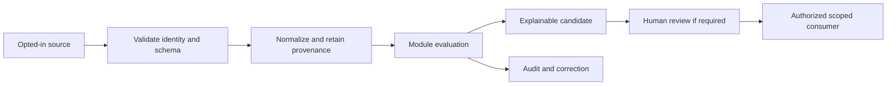

# Security Health Monitor

**Status: proposed architecture; documentation only.** This module is not implemented or deployed.

## Purpose and problems solved

Assess opt-in guild configuration and provide prioritized, reversible recommendations. It receives Authorized roles, permissions, bot/integration scopes, webhook metadata without tokens, channel overwrites. It produces Versioned findings, object IDs, rationale, severity, confidence, remediation and staleness.

## What it does

- Authorize snapshot, evaluate versioned rules, show findings/diff, admin reviews, re-scan.
- Keeps source observations, derived assessment, human decision, and local action result distinct.
- Versions rules and identifies inputs, exclusions, limitations, and reviewer state.

## What it must never do

Read-only; never mutate roles/channels/integrations/webhooks/settings or export tokens.

## Main workflow

Authorize snapshot, evaluate versioned rules, show findings/diff, admin reviews, re-scan.

## Data and API boundaries

Proposed module projections: configuration_snapshots, snapshot_objects, health_findings, remediation_reviews. Canonical events, incidents, evidence, cases and audit are defined once in [platform data architecture](../system-architecture/05-database-and-storage-architecture.md) and [shared standards](../shared-standards/README.md). Store typed references instead of duplicating source records. API conventions are shared with [Threat Intelligence API](../threat-intelligence-api/README.md).

## Security and privacy

Risks include Overbroad permissions, stale snapshot, leakage, mistaken risk classifications. Enforce least privilege, opt-in, minimization, audited sensitive reads, bounded inputs, explicit retention, scoped summaries, and fail-closed authorization. On dependency outage, expose unavailable/stale status; never turn missing data into clean findings or action authority. Retries use [idempotent delivery](../shared-standards/07-idempotency-and-delivery-standard.md).

## Dependencies and integration

Security Health Monitor connects with:

- [Incident Recovery Assistant](../incident-recovery-assistant/README.md)
- [Incident Timeline](../incident-timeline/README.md)
- [Evidence Vault](../evidence-vault/README.md)
- [Emergency Response Playbooks](../emergency-response-playbooks/README.md)
- [Attack Impact Simulator](../attack-impact-simulator/README.md)
- [Security Observatory](../security-observatory/README.md)

Cross-module records use stable event, incident, evidence, case, campaign and correlation IDs. The source context owns original evidence.

## Testing and acceptance

Use synthetic fixtures, deterministic clocks, disposable PostgreSQL, fake service identities and Discord API stubs. Primary invariant: Change creates a new snapshot/diff; stale data is labelled stale. Also test tenant isolation, duplicate/revoked events, corrections, migration rollback, restart recovery and absence of forbidden fields in logs. No live Discord action or accuracy claim.

## Implementation phase

**Proposed phase:** 5 after scope and retention review. Prerequisites include shared contracts, identity, consent, retention, audit, and outbox. See [platform roadmap](../implementation-roadmap/README.md).

## Open decisions

Cadence; retention; risk rubric; identity fields. Thresholds, retention and authority rules remain unresolved until approved and versioned.

## Data model appendix

[Module-owned PostgreSQL tables, keys, indexes, and retention notes](data-model.md).

## Document index

| # | Document | Purpose |
|---|---|---|
| 01 | [Overview and objectives](01-overview-and-objectives.md) | Contract, safeguards and implementation gate for overview and objectives. |
| 02 | [Security assessment architecture](02-security-assessment-architecture.md) | Contract, safeguards and implementation gate for security assessment architecture. |
| 03 | [Role and permission auditing](03-role-and-permission-auditing.md) | Contract, safeguards and implementation gate for role and permission auditing. |
| 04 | [Bot and integration permissions](04-bot-and-integration-permissions.md) | Contract, safeguards and implementation gate for bot and integration permissions. |
| 05 | [Webhook and channel security](05-webhook-and-channel-security.md) | Contract, safeguards and implementation gate for webhook and channel security. |
| 06 | [Configuration risk assessment](06-configuration-risk-assessment.md) | Contract, safeguards and implementation gate for configuration risk assessment. |
| 07 | [Security recommendations](07-security-recommendations.md) | Contract, safeguards and implementation gate for security recommendations. |
| 08 | [Scheduled and event-driven scans](08-scheduled-and-event-driven-scans.md) | Contract, safeguards and implementation gate for scheduled and event-driven scans. |
| 09 | [Privacy and access controls](09-privacy-and-access-controls.md) | Contract, safeguards and implementation gate for privacy and access controls. |
| 10 | [Testing and acceptance criteria](10-testing-and-acceptance-criteria.md) | Contract, safeguards and implementation gate for testing and acceptance criteria. |
| 11 | [Implementation roadmap](11-implementation-roadmap.md) | Contract, safeguards and implementation gate for implementation roadmap. |
