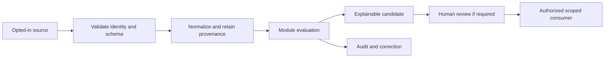

# Security Observatory

**Status: proposed architecture; documentation only.** This module is not implemented or deployed.

## Purpose and problems solved

Present role-scoped aggregate security trends without exposing allegations to broad audiences. It receives Authorized aggregates, time buckets, category/severity, source diversity, freshness, query scope. It produces Suppressed dashboard-safe trend with confidence and lineage.

## What it does

- Authorize viewer, bound query, suppress small cohort, label stale data, render, audit export.
- Keeps source observations, derived assessment, human decision, and local action result distinct.
- Versions rules and identifies inputs, exclusions, limitations, and reviewer state.

## What it must never do

No public accused list or query differencing to reconstruct incidents.

## Main workflow

Authorize viewer, bound query, suppress small cohort, label stale data, render, audit export.

## Data and API boundaries

Proposed module projections: aggregate_views, metric_snapshots, dashboard_access_events, audit_events. Canonical events, incidents, evidence, cases and audit are defined once in [platform data architecture](../system-architecture/05-database-and-storage-architecture.md) and [shared standards](../shared-standards/README.md). Store typed references instead of duplicating source records. API conventions are shared with [Threat Intelligence API](../threat-intelligence-api/README.md).

## Security and privacy

Risks include Small-cell disclosure, differencing, misleading trend, export misuse. Enforce least privilege, opt-in, minimization, audited sensitive reads, bounded inputs, explicit retention, scoped summaries, and fail-closed authorization. On dependency outage, expose unavailable/stale status; never turn missing data into clean findings or action authority. Retries use [idempotent delivery](../shared-standards/07-idempotency-and-delivery-standard.md).

## Dependencies and integration

Security Observatory connects with:
- [Incident Timeline](../incident-timeline/README.md)
- [Attack Campaign Tracker](../attack-campaign-tracker/README.md)
- [Security Advisory Network](../security-advisory-network/README.md)
- [Threat Intelligence Network](../threat-intelligence-network/README.md)
- [Trust and Reliability Engine](../trust-and-reliability-engine/README.md)

Cross-module records use stable event, incident, evidence, case, campaign and correlation IDs. The source context owns original evidence.

## Testing and acceptance

Use synthetic fixtures, deterministic clocks, disposable PostgreSQL, fake service identities and Discord API stubs. Primary invariant: Sub-floor and overlapping queries cannot reveal suppressed counts. Also test tenant isolation, duplicate/revoked events, corrections, migration rollback, restart recovery and absence of forbidden fields in logs. No live Discord action or accuracy claim.

## Implementation phase

**Proposed phase:** 7 after privacy review. Prerequisites include shared contracts, identity, consent, retention, audit, and outbox. See [platform roadmap](../implementation-roadmap/README.md).

## Open decisions

Cohort floor; staff/public fields; windows; export rights. Thresholds, retention and authority rules remain unresolved until approved and versioned.

## Data model appendix

[Module-owned PostgreSQL tables, keys, indexes, and retention notes](data-model.md).

## Document index

| # | Document | Purpose |
|---|---|---|
| 01 | [Overview and objectives](01-overview-and-objectives.md) | Contract, safeguards and implementation gate for overview and objectives. |
| 02 | [Observatory architecture](02-observatory-architecture.md) | Contract, safeguards and implementation gate for observatory architecture. |
| 03 | [Threat overview and metrics](03-threat-overview-and-metrics.md) | Contract, safeguards and implementation gate for threat overview and metrics. |
| 04 | [Campaign and incident visualization](04-campaign-and-incident-visualization.md) | Contract, safeguards and implementation gate for campaign and incident visualization. |
| 05 | [Server-level security analytics](05-server-level-security-analytics.md) | Contract, safeguards and implementation gate for server-level security analytics. |
| 06 | [Access control and data aggregation](06-access-control-and-data-aggregation.md) | Contract, safeguards and implementation gate for access control and data aggregation. |
| 07 | [Alerts and reporting](07-alerts-and-reporting.md) | Contract, safeguards and implementation gate for alerts and reporting. |
| 08 | [Testing and acceptance criteria](08-testing-and-acceptance-criteria.md) | Contract, safeguards and implementation gate for testing and acceptance criteria. |
| 09 | [Implementation roadmap](09-implementation-roadmap.md) | Contract, safeguards and implementation gate for implementation roadmap. |
