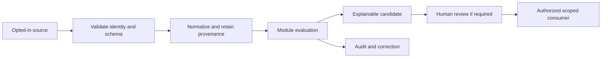

# Security Simulation Mode

**Status: proposed architecture; documentation only.** This module is not implemented or deployed.

## Purpose and problems solved

Exercise detection and response with synthetic events in isolated namespace. It receives Synthetic scenarios, seeded stream, detector versions, simulation identity. It produces Detection outcomes, simulated decisions, run manifest, safe report.

## What it does

- Create isolated run, inject events, evaluate, simulate response, compare, export sanitized report.
- Keeps source observations, derived assessment, human decision, and local action result distinct.
- Versions rules and identifies inputs, exclusions, limitations, and reviewer state.

## What it must never do

Never call Discord mutations, share synthetic incidents as real, or use production delivery.

## Main workflow

Create isolated run, inject events, evaluate, simulate response, compare, export sanitized report.

## Data and API boundaries

Proposed module projections: simulation_runs, scenario_fixtures, simulated_events, detector_results. Canonical events, incidents, evidence, cases and audit are defined once in [platform data architecture](../system-architecture/05-database-and-storage-architecture.md) and [shared standards](../shared-standards/README.md). Store typed references instead of duplicating source records. API conventions are shared with [Threat Intelligence API](../threat-intelligence-api/README.md).

## Security and privacy

Risks include Environment crossing, credential leak, synthetic/real confusion. Enforce least privilege, opt-in, minimization, audited sensitive reads, bounded inputs, explicit retention, scoped summaries, and fail-closed authorization. On dependency outage, expose unavailable/stale status; never turn missing data into clean findings or action authority. Retries use [idempotent delivery](../shared-standards/07-idempotency-and-delivery-standard.md).

## Dependencies and integration

Security Simulation Mode connects with:
- [Early Raid Detection](../early-raid-detection/README.md)
- [Suspicious Admin Activity](../suspicious-admin-activity/README.md)
- [Threat DNA](../threat-dna/README.md)
- [Emergency Response Playbooks](../emergency-response-playbooks/README.md)
- [Attack Impact Simulator](../attack-impact-simulator/README.md)
- [Incident Timeline](../incident-timeline/README.md)
- [Security Observatory](../security-observatory/README.md)

Cross-module records use stable event, incident, evidence, case, campaign and correlation IDs. The source context owns original evidence.

## Testing and acceptance

Use synthetic fixtures, deterministic clocks, disposable PostgreSQL, fake service identities and Discord API stubs. Primary invariant: No mutation egress; synthetic tenant cannot query production cases. Also test tenant isolation, duplicate/revoked events, corrections, migration rollback, restart recovery and absence of forbidden fields in logs. No live Discord action or accuracy claim.

## Implementation phase

**Proposed phase:** 4 after fixtures and isolation. Prerequisites include shared contracts, identity, consent, retention, audit, and outbox. See [platform roadmap](../implementation-roadmap/README.md).

## Open decisions

Local/staging/hosted; scenario review. Thresholds, retention and authority rules remain unresolved until approved and versioned.

## Data model appendix

[Module-owned PostgreSQL tables, keys, indexes, and retention notes](data-model.md).

## Document index

| # | Document | Purpose |
|---|---|---|
| 01 | [Overview and objectives](01-overview-and-objectives.md) | Contract, safeguards and implementation gate for overview and objectives. |
| 02 | [Simulation engine architecture](02-simulation-engine-architecture.md) | Contract, safeguards and implementation gate for simulation engine architecture. |
| 03 | [Synthetic attack scenarios](03-synthetic-attack-scenarios.md) | Contract, safeguards and implementation gate for synthetic attack scenarios. |
| 04 | [Detection and response testing](04-detection-and-response-testing.md) | Contract, safeguards and implementation gate for detection and response testing. |
| 05 | [Isolation and safety guards](05-isolation-and-safety-guards.md) | Contract, safeguards and implementation gate for isolation and safety guards. |
| 06 | [Results and reporting](06-results-and-reporting.md) | Contract, safeguards and implementation gate for results and reporting. |
| 07 | [Testing and acceptance criteria](07-testing-and-acceptance-criteria.md) | Contract, safeguards and implementation gate for testing and acceptance criteria. |
| 08 | [Implementation roadmap](08-implementation-roadmap.md) | Contract, safeguards and implementation gate for implementation roadmap. |
