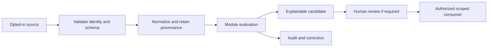

# Suspicious Admin Activity

**Status: proposed architecture; documentation only.** This module is not implemented or deployed.

## Purpose and problems solved

Surface unusual privileged actions for evidence-led investigation. It receives Audit entries, actor/target IDs, role/channel changes, mass bans, webhook events, outcome and local baseline. It produces Attributed timeline event, attribution confidence and review case.

## What it does

- Observe, match fresh target-specific audit record, compare baseline, explain anomaly, alert staff, review/correct.
- Keeps source observations, derived assessment, human decision, and local action result distinct.
- Versions rules and identifies inputs, exclusions, limitations, and reviewer state.

## What it must never do

Unmatched remains unattributed; unusual is not proof of compromise; never revoke roles automatically.

## Main workflow

Observe, match fresh target-specific audit record, compare baseline, explain anomaly, alert staff, review/correct.

## Data and API boundaries

Proposed module projections: admin_events, actor_attributions, behavior_baselines, cases, evidence_refs. Canonical events, incidents, evidence, cases and audit are defined once in [platform data architecture](../system-architecture/05-database-and-storage-architecture.md) and [shared standards](../shared-standards/README.md). Store typed references instead of duplicating source records. API conventions are shared with [Threat Intelligence API](../threat-intelligence-api/README.md).

## Security and privacy

Risks include Audit ambiguity, legitimate bulk work, compromised bot, insider retaliation. Enforce least privilege, opt-in, minimization, audited sensitive reads, bounded inputs, explicit retention, scoped summaries, and fail-closed authorization. On dependency outage, expose unavailable/stale status; never turn missing data into clean findings or action authority. Retries use [idempotent delivery](../shared-standards/07-idempotency-and-delivery-standard.md).

## Dependencies and integration

Suspicious Admin Activity connects with:

- [Early Raid Detection](../early-raid-detection/README.md)
- [Incident Timeline](../incident-timeline/README.md)
- [Evidence Vault](../evidence-vault/README.md)
- [Emergency Response Playbooks](../emergency-response-playbooks/README.md)
- [Attack Impact Simulator](../attack-impact-simulator/README.md)
- [Security Health Monitor](../security-health-monitor/README.md)
- [Trust and Reliability Engine](../trust-and-reliability-engine/README.md)

Cross-module records use stable event, incident, evidence, case, campaign and correlation IDs. The source context owns original evidence.

## Testing and acceptance

Use synthetic fixtures, deterministic clocks, disposable PostgreSQL, fake service identities and Discord API stubs. Primary invariant: Unmatched mass action opens unattributed event, not accusation. Also test tenant isolation, duplicate/revoked events, corrections, migration rollback, restart recovery and absence of forbidden fields in logs. No live Discord action or accuracy claim.

## Implementation phase

**Proposed phase:** 4 after attribution tests. Prerequisites include shared contracts, identity, consent, retention, audit, and outbox. See [platform roadmap](../implementation-roadmap/README.md).

## Open decisions

Baseline; maintenance annotations; notification privacy; thresholds. Thresholds, retention and authority rules remain unresolved until approved and versioned.

## Data model appendix

[Module-owned PostgreSQL tables, keys, indexes, and retention notes](data-model.md).

## Document index

| # | Document | Purpose |
|---|---|---|
| 01 | [Overview and objectives](01-overview-and-objectives.md) | Contract, safeguards and implementation gate for overview and objectives. |
| 02 | [Monitoring architecture](02-monitoring-architecture.md) | Contract, safeguards and implementation gate for monitoring architecture. |
| 03 | [Administrative event collection](03-administrative-event-collection.md) | Contract, safeguards and implementation gate for administrative event collection. |
| 04 | [Behavioral baselines](04-behavioral-baselines.md) | Contract, safeguards and implementation gate for behavioral baselines. |
| 05 | [Permission escalation detection](05-permission-escalation-detection.md) | Contract, safeguards and implementation gate for permission escalation detection. |
| 06 | [Mass action and destructive event detection](06-mass-action-and-destructive-event-detection.md) | Contract, safeguards and implementation gate for mass action and destructive event detection. |
| 07 | [Compromised account investigation](07-compromised-account-investigation.md) | Contract, safeguards and implementation gate for compromised account investigation. |
| 08 | [Alerts and human review](08-alerts-and-human-review.md) | Contract, safeguards and implementation gate for alerts and human review. |
| 09 | [False-positive and insider-abuse protection](09-false-positive-and-insider-abuse-protection.md) | Contract, safeguards and implementation gate for false-positive and insider-abuse protection. |
| 10 | [Testing and acceptance criteria](10-testing-and-acceptance-criteria.md) | Contract, safeguards and implementation gate for testing and acceptance criteria. |
| 11 | [Implementation roadmap](11-implementation-roadmap.md) | Contract, safeguards and implementation gate for implementation roadmap. |
