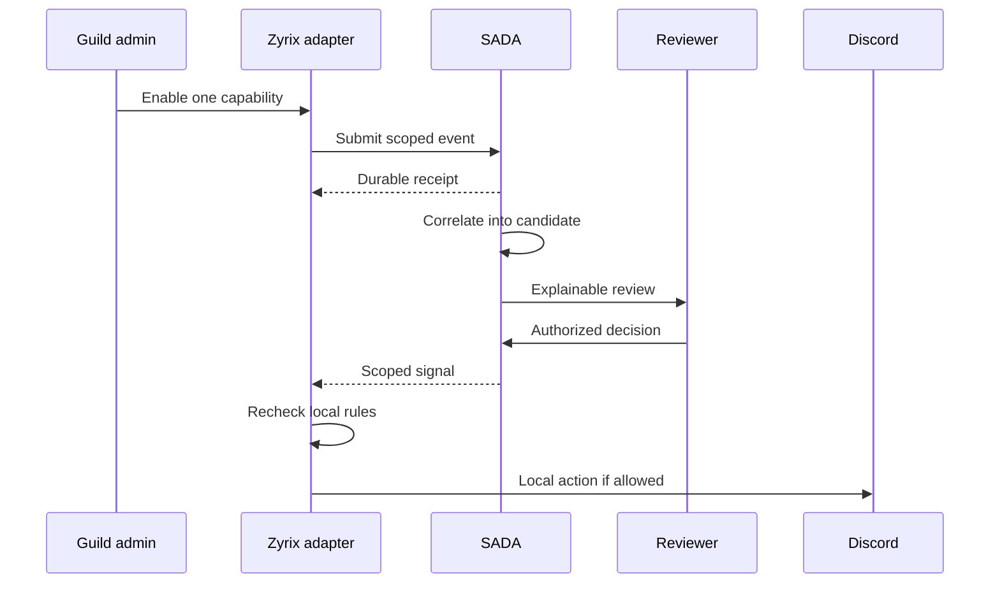

# 01 — Platform overview

**Existing:** documentation only. **Proposed:** independent security-intelligence platform for opted-in guilds. Bounded contexts: identity/consent, ingestion, incidents/evidence, analysis, cases/review/appeals, distribution, operations, and Discord execution in Zyrix only.

PostgreSQL is source of truth; Discord messages/UI are projections; optional encrypted object store holds approved evidence. Missing data is unknown. SADA outage affects intelligence only.
