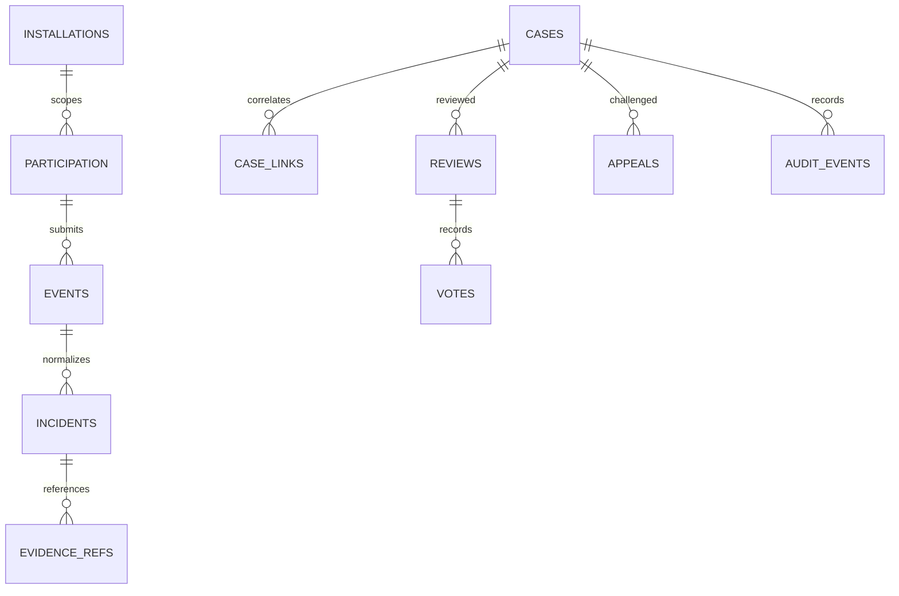

# 05 — Database and storage architecture

PostgreSQL owns installations/consent, inbox/events, incidents/revisions, evidence metadata, cases/links, reviews/votes, appeals, timeline/graph refs, outbox/delivery, local receipts, audit. Optional object storage holds approved encrypted evidence bytes. Use UUID internal IDs, canonical decimal snowflakes, UTC TIMESTAMPTZ, FK/CHECK, unique idempotency, tenant/time indexes and migrations. No cascade deletion of audits. Workers atomically write result, audit and outbox. Secrets stay in secret manager.

Modules own only projections such as baselines, indicators, snapshots, campaigns and simulations.

## Canonical column and constraint proposal

These are shared logical tables; exact SQL types/enums and retention need migration review. All timestamps are UTC. Use append-only revisions for corrections.

| Table | Proposed columns and keys | Core constraints / indexes |
|---|---|---|
| installations | installation_id UUID PK, key_id TEXT, status TEXT, created_at TIMESTAMPTZ, revoked_at TIMESTAMPTZ | CHECK status; index status; secret bytes stay outside DB |
| participating_guilds | guild_id BIGINT PK, installation_id UUID FK, submit_enabled/receive_enabled/alerts_enabled/enforcement_enabled BOOLEAN NOT NULL DEFAULT false, consent_version TEXT, configured_by BIGINT, configured_at TIMESTAMPTZ, state TEXT | index installation_id/state; all off by default; consent change emits audit |
| inbox_events | inbox_id UUID PK, installation_id UUID FK, event_id UUID, idempotency_key TEXT, body_hash BYTEA, received_at TIMESTAMPTZ, status TEXT, attempts INTEGER, next_attempt_at TIMESTAMPTZ | UNIQUE (installation_id,event_id), UNIQUE (installation_id,idempotency_key); status/next_attempt index |
| events | event_id UUID PK, installation_id UUID FK, source_guild_id BIGINT FK, event_type TEXT, schema_version TEXT, occurred_at/observed_at/received_at TIMESTAMPTZ, consent_version TEXT, correlation_id UUID, payload_ref UUID | index (source_guild_id,occurred_at), event_type/time; payload bounded and typed |
| incidents | incident_id UUID PK, event_id UUID FK UNIQUE, source_guild_id BIGINT, subject_user_id BIGINT, occurred_at TIMESTAMPTZ, action_type TEXT, original_reason_ciphertext BYTEA NULL, evidence_status TEXT, actor_id BIGINT NULL, source_confidence TEXT, revision INTEGER, retention_until TIMESTAMPTZ | CHECK evidence status; index (subject_user_id,occurred_at) via event join/projection; correction links append-only |
| evidence_refs | evidence_id UUID PK, incident_id UUID FK, evidence_type TEXT, source_ref TEXT NULL, digest BYTEA NULL, access_scope TEXT, captured_at TIMESTAMPTZ, retention_until TIMESTAMPTZ | index incident_id/type; blob itself external encrypted object |
| cases | case_id UUID PK, subject_user_id BIGINT, status TEXT, revision INTEGER, policy_version TEXT, created_at/updated_at TIMESTAMPTZ, evidence_snapshot_hash BYTEA, expiry_at TIMESTAMPTZ NULL | index status/updated_at and subject/status; revision compare-and-set |
| case_links | case_id UUID FK, incident_id UUID FK, relation TEXT, inclusion_state TEXT, explanation JSONB, created_at TIMESTAMPTZ, PRIMARY KEY(case_id,incident_id,relation) | index incident_id; never delete excluded links |
| global_reviews | review_id UUID PK, case_id UUID FK, status TEXT, case_revision INTEGER, evidence_snapshot_hash BYTEA, required_quorum INTEGER, policy_version TEXT, proposed_at/closed_at TIMESTAMPTZ | index case/status; decision binds to evidence revision |
| reviewer_votes | vote_id UUID PK, review_id UUID FK, reviewer_id BIGINT, vote TEXT, reason TEXT, decided_at TIMESTAMPTZ, vote_revision INTEGER | index reviewer/time; unique review+reviewer+revision; quorum checked transactionally |
| appeals | appeal_id UUID PK, case_id UUID FK, appellant_ref TEXT, status TEXT, statement_ciphertext BYTEA, submitted_at/resolved_at TIMESTAMPTZ, resolution_ref UUID NULL | index case/status; restricted access and retention |
| source_quality_observations | observation_id UUID PK, source_guild_id BIGINT FK, window_start/end TIMESTAMPTZ, denominator INTEGER, completeness_rate NUMERIC, audit_consistency_rate NUMERIC, correction_rate NUMERIC, methodology_version TEXT | UNIQUE(source_guild_id,window_start,window_end,methodology_version); low sample is insufficient data |
| score_snapshots | score_id UUID PK, case_id UUID FK, scorer_version TEXT, policy_version TEXT, calculated_at TIMESTAMPTZ, breakdown JSONB, included/excluded incident IDs JSONB | index case/calculated_at; immutable explanatory snapshot, never action authority |
| alerts | alert_id UUID PK, case_id UUID FK, guild_id BIGINT FK, case_revision INTEGER, status TEXT, message_id BIGINT NULL, created_at TIMESTAMPTZ, expires_at TIMESTAMPTZ | UNIQUE(case_id,guild_id,case_revision); require confirmed membership before delivery |
| local_decisions | decision_id UUID PK, alert_id UUID FK UNIQUE, guild_id BIGINT FK, actor_id BIGINT, decision TEXT, decided_at TIMESTAMPTZ, idempotency_key TEXT UNIQUE | ban/ignore are guild-local; ignore is not global rejection |
| enforcement_attempts | enforcement_id UUID PK, review_id UUID FK, guild_id BIGINT FK, status TEXT, attempts INTEGER, started_at/completed_at TIMESTAMPTZ, idempotency_key TEXT UNIQUE | UNIQUE(review_id,guild_id,policy_version); success/skip/failure/unknown distinct |
| delivery_outbox | delivery_id UUID PK, recipient_installation UUID FK, aggregate_id UUID, aggregate_revision INTEGER, delivery_type TEXT, payload_ref UUID, status TEXT, attempts INTEGER, next_attempt_at TIMESTAMPTZ, expires_at TIMESTAMPTZ | UNIQUE (recipient_installation,aggregate_id,aggregate_revision,delivery_type); status/next_attempt index |
| local_action_receipts | receipt_id UUID PK, decision_id UUID, guild_id BIGINT, target_user_id BIGINT, outcome TEXT, safe_error_code TEXT NULL, discord_audit_ref TEXT NULL, occurred_at TIMESTAMPTZ, idempotency_key TEXT UNIQUE | UNIQUE (decision_id,guild_id); success/skip/failure/unknown distinct |
| audit_events | audit_id UUID PK, actor_type TEXT, actor_ref TEXT, action TEXT, object_type TEXT, object_id UUID, object_revision INTEGER, request_id TEXT, occurred_at/recorded_at TIMESTAMPTZ, outcome TEXT, summary JSONB | index object/time and actor/time; app role has INSERT/SELECT, no UPDATE/DELETE |

Module-specific entities in feature chapters use the same conventions: module UUID primary key, canonical foreign references, guild scope where applicable, source/event revision, policy or algorithm version, created_at/updated_at, explicit state CHECK, and retention_until when data is personal or evidence-bearing. Each module must declare its own domain columns, uniqueness and query indexes before migration approval.

## Migration, retention, and ownership

Migrations are ordered, checksummed, forward-compatible where possible, tested from empty and previous versions, and never auto-reset a production database. Destructive changes require a reviewed backfill, backup, and rollback/forward plan. Retention workers delete only eligible records under explicit policy; holds are separately audited. Feature module owns its projection; identity owns consent, ingestion owns inbox, incident/evidence own source records, case service owns case state, governance owns votes/appeals, delivery owns outbox, and audit is append-only.
