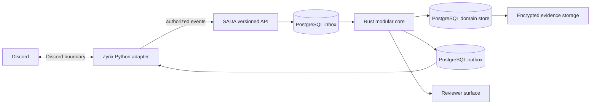

# Shared Platform Architecture

**Proposed only; no service is deployed.** Feature docs may refine domain rules but cannot redefine event, evidence, case, identity, error or audit contracts.

Zyrix owns Discord, consent UI, live checks and every action. API authenticates and durably accepts; Rust processes; PostgreSQL stores structured state; reviewers decide. Start as independent modular API/worker plus PostgreSQL; defer broker/cache. See [governance](../security-and-governance/README.md), [standards](../shared-standards/README.md), [roadmap](../implementation-roadmap/README.md).
