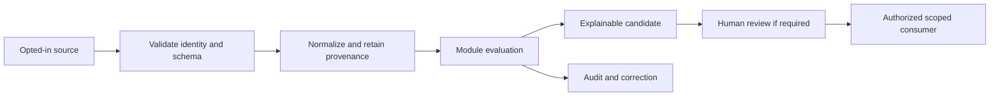

# Threat DNA

**Status: proposed architecture; documentation only.** This module is not implemented or deployed.

## Purpose and problems solved

Create privacy-bounded, versioned fingerprints of attack behavior for explainable comparison. It receives Permitted timing buckets, action sequences, URL/domain indicators, approved template hashes, provenance. It produces Versioned fingerprint and factor-level similarity explanation.

## What it does

- Normalize allowed signals, omit prohibited content, generate scoped fingerprint, compare, explain matched dimensions.
- Keeps source observations, derived assessment, human decision, and local action result distinct.
- Versions rules and identifies inputs, exclusions, limitations, and reviewer state.

## What it must never do

Similarity is not identity or guilt; no private conversations, device fingerprints, or permanent cross-context links.

## Main workflow

Normalize allowed signals, omit prohibited content, generate scoped fingerprint, compare, explain matched dimensions.

## Data and API boundaries

Proposed module projections: fingerprints, fingerprint_features, relationship_edges, incidents, audit_events. Canonical events, incidents, evidence, cases and audit are defined once in [platform data architecture](../system-architecture/05-database-and-storage-architecture.md) and [shared standards](../shared-standards/README.md). Store typed references instead of duplicating source records. API conventions are shared with [Threat Intelligence API](../threat-intelligence-api/README.md).

## Security and privacy

Risks include Dictionary attacks, re-identification, mutation, collision, overfitting. Enforce least privilege, opt-in, minimization, audited sensitive reads, bounded inputs, explicit retention, scoped summaries, and fail-closed authorization. On dependency outage, expose unavailable/stale status; never turn missing data into clean findings or action authority. Retries use [idempotent delivery](../shared-standards/07-idempotency-and-delivery-standard.md).

## Dependencies and integration

Threat DNA connects with:

- [Early Raid Detection](../early-raid-detection/README.md)
- [Scam and Phishing Intelligence](../scam-and-phishing-intelligence/README.md)
- [Threat Intelligence Network](../threat-intelligence-network/README.md)
- [Attack Campaign Tracker](../attack-campaign-tracker/README.md)
- [Evidence Vault](../evidence-vault/README.md)
- [Trust and Reliability Engine](../trust-and-reliability-engine/README.md)

Cross-module records use stable event, incident, evidence, case, campaign and correlation IDs. The source context owns original evidence.

## Testing and acceptance

Use synthetic fixtures, deterministic clocks, disposable PostgreSQL, fake service identities and Discord API stubs. Primary invariant: Unrelated synthetic incidents do not correlate; wording changes affect only designed dimensions. Also test tenant isolation, duplicate/revoked events, corrections, migration rollback, restart recovery and absence of forbidden fields in logs. No live Discord action or accuracy claim.

## Implementation phase

**Proposed phase:** 3 after privacy review and synthetic corpus. Prerequisites include shared contracts, identity, consent, retention, audit, and outbox. See [platform roadmap](../implementation-roadmap/README.md).

## Open decisions

Allowed features; key rotation; scope; threshold; evaluation corpus. Thresholds, retention and authority rules remain unresolved until approved and versioned.

## Data model appendix

[Module-owned PostgreSQL tables, keys, indexes, and retention notes](data-model.md).

## Document index

| # | Document | Purpose |
|---|---|---|
| 01 | [Overview and objectives](01-overview-and-objectives.md) | Contract, safeguards and implementation gate for overview and objectives. |
| 02 | [Attack fingerprint architecture](02-attack-fingerprint-architecture.md) | Contract, safeguards and implementation gate for attack fingerprint architecture. |
| 03 | [Signal extraction and normalization](03-signal-extraction-and-normalization.md) | Contract, safeguards and implementation gate for signal extraction and normalization. |
| 04 | [Fingerprint generation](04-fingerprint-generation.md) | Contract, safeguards and implementation gate for fingerprint generation. |
| 05 | [Pattern matching and correlation](05-pattern-matching-and-correlation.md) | Contract, safeguards and implementation gate for pattern matching and correlation. |
| 06 | [Campaign identification](06-campaign-identification.md) | Contract, safeguards and implementation gate for campaign identification. |
| 07 | [Confidence and explainability](07-confidence-and-explainability.md) | Contract, safeguards and implementation gate for confidence and explainability. |
| 08 | [Privacy and data minimization](08-privacy-and-data-minimization.md) | Contract, safeguards and implementation gate for privacy and data minimization. |
| 09 | [False-positive prevention](09-false-positive-prevention.md) | Contract, safeguards and implementation gate for false-positive prevention. |
| 10 | [Testing and acceptance criteria](10-testing-and-acceptance-criteria.md) | Contract, safeguards and implementation gate for testing and acceptance criteria. |
| 11 | [Implementation roadmap](11-implementation-roadmap.md) | Contract, safeguards and implementation gate for implementation roadmap. |
