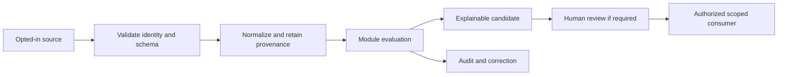

# Threat Intelligence API

**Status: proposed architecture; documentation only.** This module is not implemented or deployed.

## Purpose and problems solved

Expose scoped, versioned summaries to authorized integrations with audited access and no action authority. It receives Authenticated identity, scopes, bounded query, cursor, fields, idempotency. It produces Versioned allowed summary, freshness, provenance, correction.

## What it does

- Authenticate, authorize tenant/object, validate limits, query projection, redact, return cursor, audit.
- Keeps source observations, derived assessment, human decision, and local action result distinct.
- Versions rules and identifies inputs, exclusions, limitations, and reviewer state.

## What it must never do

No public accused-user search, raw evidence by default, secrets, or Discord action authority.

## Main workflow

Authenticate, authorize tenant/object, validate limits, query projection, redact, return cursor, audit.

## Data and API boundaries

Proposed module projections: installations, access_grants, rate_windows, audit_events, delivery_receipts. Canonical events, incidents, evidence, cases and audit are defined once in [platform data architecture](../system-architecture/05-database-and-storage-architecture.md) and [shared standards](../shared-standards/README.md). Store typed references instead of duplicating source records. API conventions are shared with [Threat Intelligence API](../threat-intelligence-api/README.md).

## Security and privacy

Risks include Key theft, enumeration, tenant escape, replay, overbroad scope. Enforce least privilege, opt-in, minimization, audited sensitive reads, bounded inputs, explicit retention, scoped summaries, and fail-closed authorization. On dependency outage, expose unavailable/stale status; never turn missing data into clean findings or action authority. Retries use [idempotent delivery](../shared-standards/07-idempotency-and-delivery-standard.md).

## Dependencies and integration

Threat Intelligence API connects with:

- [Global Ban System](../global-ban-system/README.md)
- [Threat Intelligence Network](../threat-intelligence-network/README.md)
- [Threat DNA](../threat-dna/README.md)
- [Early Raid Detection](../early-raid-detection/README.md)
- [Scam and Phishing Intelligence](../scam-and-phishing-intelligence/README.md)
- [Security Health Monitor](../security-health-monitor/README.md)
- [Suspicious Admin Activity](../suspicious-admin-activity/README.md)
- [Emergency Response Playbooks](../emergency-response-playbooks/README.md)
- [Attack Impact Simulator](../attack-impact-simulator/README.md)
- [Ban Evasion Intelligence](../ban-evasion-intelligence/README.md)
- [Incident Timeline](../incident-timeline/README.md)
- [Evidence Vault](../evidence-vault/README.md)
- [Trust and Reliability Engine](../trust-and-reliability-engine/README.md)
- [Security Advisory Network](../security-advisory-network/README.md)
- [Attack Campaign Tracker](../attack-campaign-tracker/README.md)
- [Security Simulation Mode](../security-simulation-mode/README.md)
- [Incident Recovery Assistant](../incident-recovery-assistant/README.md)
- [Security Advisory Network](../security-advisory-network/README.md)
- [Security Observatory](../security-observatory/README.md)

Cross-module records use stable event, incident, evidence, case, campaign and correlation IDs. The source context owns original evidence.

## Testing and acceptance

Use synthetic fixtures, deterministic clocks, disposable PostgreSQL, fake service identities and Discord API stubs. Primary invariant: Guild key cannot read another guild evidence; revoke fails; cursor cannot widen. Also test tenant isolation, duplicate/revoked events, corrections, migration rollback, restart recovery and absence of forbidden fields in logs. No live Discord action or accuracy claim.

## Implementation phase

**Proposed phase:** 2 internal; external after review. Prerequisites include shared contracts, identity, consent, retention, audit, and outbox. See [platform roadmap](../implementation-roadmap/README.md).

## Open decisions

Audience; identity; quota; public aggregate policy. Thresholds, retention and authority rules remain unresolved until approved and versioned.

## Data model appendix

[Module-owned PostgreSQL tables, keys, indexes, and retention notes](data-model.md).

## Document index

| # | Document | Purpose |
|---|---|---|
| 01 | [Overview and objectives](01-overview-and-objectives.md) | Contract, safeguards and implementation gate for overview and objectives. |
| 02 | [API architecture and versioning](02-api-architecture-and-versioning.md) | Contract, safeguards and implementation gate for api architecture and versioning. |
| 03 | [Authentication and authorization](03-authentication-and-authorization.md) | Contract, safeguards and implementation gate for authentication and authorization. |
| 04 | [Endpoints and contracts](04-endpoints-and-contracts.md) | Contract, safeguards and implementation gate for endpoints and contracts. |
| 05 | [Rate limits and abuse prevention](05-rate-limits-and-abuse-prevention.md) | Contract, safeguards and implementation gate for rate limits and abuse prevention. |
| 06 | [Data access and privacy](06-data-access-and-privacy.md) | Contract, safeguards and implementation gate for data access and privacy. |
| 07 | [Integration guidelines](07-integration-guidelines.md) | Contract, safeguards and implementation gate for integration guidelines. |
| 08 | [Testing and acceptance criteria](08-testing-and-acceptance-criteria.md) | Contract, safeguards and implementation gate for testing and acceptance criteria. |
| 09 | [Implementation roadmap](09-implementation-roadmap.md) | Contract, safeguards and implementation gate for implementation roadmap. |
