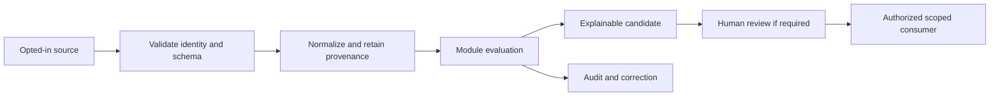

# Threat Intelligence Network

**Status: proposed architecture; documentation only.** This module is not implemented or deployed.

## Purpose and problems solved

Correlate provenance-bearing security incidents across independently opted-in installations. It receives Authorized incidents, source-guild scope, event/evidence references, correction state, consent version. It produces Candidate typed relationships and scoped intelligence, never verdicts.

## What it does

- Validate independent source, add typed graph edges, evaluate provenance, route candidate links for review.
- Keeps source observations, derived assessment, human decision, and local action result distinct.
- Versions rules and identifies inputs, exclusions, limitations, and reviewer state.

## What it must never do

One guild, installation, retry, or copied report never counts as several independent sources.

## Main workflow

Validate independent source, add typed graph edges, evaluate provenance, route candidate links for review.

## Data and API boundaries

Proposed module projections: incidents, relationship_edges, cases, case_links, audit_events. Canonical events, incidents, evidence, cases and audit are defined once in [platform data architecture](../system-architecture/05-database-and-storage-architecture.md) and [shared standards](../shared-standards/README.md). Store typed references instead of duplicating source records. API conventions are shared with [Threat Intelligence API](../threat-intelligence-api/README.md).

## Security and privacy

Risks include Sybil reports, collusion, graph traversal leakage, evidence poisoning. Enforce least privilege, opt-in, minimization, audited sensitive reads, bounded inputs, explicit retention, scoped summaries, and fail-closed authorization. On dependency outage, expose unavailable/stale status; never turn missing data into clean findings or action authority. Retries use [idempotent delivery](../shared-standards/07-idempotency-and-delivery-standard.md).

## Dependencies and integration

Threat Intelligence Network connects with:
- [Threat DNA](../threat-dna/README.md)
- [Incident Timeline](../incident-timeline/README.md)
- [Evidence Vault](../evidence-vault/README.md)
- [Trust and Reliability Engine](../trust-and-reliability-engine/README.md)
- [Attack Campaign Tracker](../attack-campaign-tracker/README.md)
- [Security Advisory Network](../security-advisory-network/README.md)
- [Global Ban System](../global-ban-system/README.md)

Cross-module records use stable event, incident, evidence, case, campaign and correlation IDs. The source context owns original evidence.

## Testing and acceptance

Use synthetic fixtures, deterministic clocks, disposable PostgreSQL, fake service identities and Discord API stubs. Primary invariant: Duplicates from one source create one edge; reversal removes active support but retains audit history. Also test tenant isolation, duplicate/revoked events, corrections, migration rollback, restart recovery and absence of forbidden fields in logs. No live Discord action or accuracy claim.

## Implementation phase

**Proposed phase:** 2 after consent and event contracts. Prerequisites include shared contracts, identity, consent, retention, audit, and outbox. See [platform roadmap](../implementation-roadmap/README.md).

## Open decisions

Cross-guild pseudonymous links; independence policy; source identity visibility. Thresholds, retention and authority rules remain unresolved until approved and versioned.

## Data model appendix

[Module-owned PostgreSQL tables, keys, indexes, and retention notes](data-model.md).

## Document index

| # | Document | Purpose |
|---|---|---|
| 01 | [Overview and objectives](01-overview-and-objectives.md) | Contract, safeguards and implementation gate for overview and objectives. |
| 02 | [Threat network architecture](02-threat-network-architecture.md) | Contract, safeguards and implementation gate for threat network architecture. |
| 03 | [Incident ingestion and normalization](03-incident-ingestion-and-normalization.md) | Contract, safeguards and implementation gate for incident ingestion and normalization. |
| 04 | [Threat correlation and relationship graph](04-threat-correlation-and-relationship-graph.md) | Contract, safeguards and implementation gate for threat correlation and relationship graph. |
| 05 | [Cross-server intelligence sharing](05-cross-server-intelligence-sharing.md) | Contract, safeguards and implementation gate for cross-server intelligence sharing. |
| 06 | [Evidence provenance and confidence](06-evidence-provenance-and-confidence.md) | Contract, safeguards and implementation gate for evidence provenance and confidence. |
| 07 | [Data model and database](07-data-model-and-database.md) | Contract, safeguards and implementation gate for data model and database. |
| 08 | [Security and privacy](08-security-and-privacy.md) | Contract, safeguards and implementation gate for security and privacy. |
| 09 | [Review and governance](09-review-and-governance.md) | Contract, safeguards and implementation gate for review and governance. |
| 10 | [Testing and acceptance criteria](10-testing-and-acceptance-criteria.md) | Contract, safeguards and implementation gate for testing and acceptance criteria. |
| 11 | [Implementation roadmap](11-implementation-roadmap.md) | Contract, safeguards and implementation gate for implementation roadmap. |
