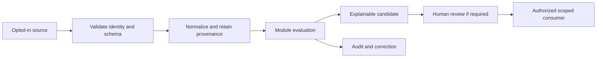

# Trust and Reliability Engine

**Status: proposed architecture; documentation only.** This module is not implemented or deployed.

## Purpose and problems solved

Expose evidence/source quality with uncertainty without permanently labeling communities or people. It receives Provenance, audit matches, duplicate/correction history, dispositions, denominator, method version. It produces Factor-level quality profile, sample sufficiency, uncertainty, review suggestion.

## What it does

- Compute factors, minimum denominator, separate source/reporter/context, explain, allow challenge.
- Keeps source observations, derived assessment, human decision, and local action result distinct.
- Versions rules and identifies inputs, exclusions, limitations, and reviewer state.

## What it must never do

No penalty for appeal count alone, opaque permanent score, automatic source exclusion.

## Main workflow

Compute factors, minimum denominator, separate source/reporter/context, explain, allow challenge.

## Data and API boundaries

Proposed module projections: source_quality_observations, methodology_versions, source_reviews, correction_links. Canonical events, incidents, evidence, cases and audit are defined once in [platform data architecture](../system-architecture/05-database-and-storage-architecture.md) and [shared standards](../shared-standards/README.md). Store typed references instead of duplicating source records. API conventions are shared with [Threat Intelligence API](../threat-intelligence-api/README.md).

## Security and privacy

Risks include Feedback loops, bias, false reports, small samples, retaliation. Enforce least privilege, opt-in, minimization, audited sensitive reads, bounded inputs, explicit retention, scoped summaries, and fail-closed authorization. On dependency outage, expose unavailable/stale status; never turn missing data into clean findings or action authority. Retries use [idempotent delivery](../shared-standards/07-idempotency-and-delivery-standard.md).

## Dependencies and integration

Trust and Reliability Engine connects with:
- [Evidence Vault](../evidence-vault/README.md)
- [Global Ban System](../global-ban-system/README.md)
- [Threat Intelligence Network](../threat-intelligence-network/README.md)
- [Attack Campaign Tracker](../attack-campaign-tracker/README.md)

Cross-module records use stable event, incident, evidence, case, campaign and correlation IDs. The source context owns original evidence.

## Testing and acceptance

Use synthetic fixtures, deterministic clocks, disposable PostgreSQL, fake service identities and Discord API stubs. Primary invariant: Small denominator means insufficient data; corrections affect only defined factors. Also test tenant isolation, duplicate/revoked events, corrections, migration rollback, restart recovery and absence of forbidden fields in logs. No live Discord action or accuracy claim.

## Implementation phase

**Proposed phase:** 3 after governance/evaluation corpus. Prerequisites include shared contracts, identity, consent, retention, audit, and outbox. See [platform roadmap](../implementation-roadmap/README.md).

## Open decisions

Sample floor; weights; reviewer; transparency; cadence. Thresholds, retention and authority rules remain unresolved until approved and versioned.

## Data model appendix

[Module-owned PostgreSQL tables, keys, indexes, and retention notes](data-model.md).

## Document index

| # | Document | Purpose |
|---|---|---|
| 01 | [Overview and objectives](01-overview-and-objectives.md) | Contract, safeguards and implementation gate for overview and objectives. |
| 02 | [Reliability architecture](02-reliability-architecture.md) | Contract, safeguards and implementation gate for reliability architecture. |
| 03 | [Evidence quality assessment](03-evidence-quality-assessment.md) | Contract, safeguards and implementation gate for evidence quality assessment. |
| 04 | [Reporter and source reliability](04-reporter-and-source-reliability.md) | Contract, safeguards and implementation gate for reporter and source reliability. |
| 05 | [Correction and appeal history](05-correction-and-appeal-history.md) | Contract, safeguards and implementation gate for correction and appeal history. |
| 06 | [Coordinated false-report detection](06-coordinated-false-report-detection.md) | Contract, safeguards and implementation gate for coordinated false-report detection. |
| 07 | [Bias and fairness protection](07-bias-and-fairness-protection.md) | Contract, safeguards and implementation gate for bias and fairness protection. |
| 08 | [Testing and acceptance criteria](08-testing-and-acceptance-criteria.md) | Contract, safeguards and implementation gate for testing and acceptance criteria. |
| 09 | [Implementation roadmap](09-implementation-roadmap.md) | Contract, safeguards and implementation gate for implementation roadmap. |
